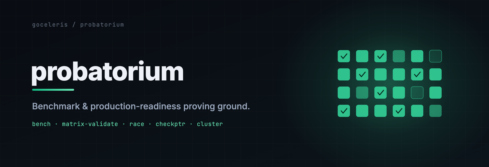

<p align="center">
  
</p>

<p align="center">
  <a href="https://github.com/goceleris/probatorium/actions/workflows/test.yml?query=branch%3Amain"></a>
  <a href="https://github.com/goceleris/probatorium/actions/workflows/lint.yml?query=branch%3Amain"></a>
  <a href="https://codecov.io/gh/goceleris/probatorium"></a>
  <a href="go.mod"></a>
  <a href="LICENSE"></a>
</p>

<p align="center">
  <strong>The benchmark and validation harness for <a href="https://github.com/goceleris/celeris">celeris</a>: it drives a real three-host cluster, x86 and arm64, and asks every celeris build how fast it is and whether it stays correct under stress.</strong>
</p>

<p align="center">
  <a href="#why-probatorium">Why</a> ·
  <a href="#quick-start">Quick start</a> ·
  <a href="#tiers">Tiers</a> ·
  <a href="#results">Results</a> ·
  <a href="#reproduce-a-run">Reproduce a run</a> ·
  <a href="https://goceleris.dev/benchmarks/">Benchmark dashboard</a> ·
  <a href="https://goceleris.dev/methodology/">Methodology</a>
</p>

## At a glance

**What it is.** probatorium is the benchmark and validation harness for celeris. On a three-host cluster (x86-64 and arm64) it measures celeris against 29 other frameworks under load, and it runs celeris reference apps on every engine against malformed traffic, connection churn and injected faults to judge correctness.

**Run it.** The deterministic parts run on a laptop with Go, with no cluster, docker or root:

```sh
git clone https://github.com/goceleris/probatorium && cd probatorium
go run ./cmd/runner -dry-run -cells '*/*' -runs 1   # list every benchmark cell a full run schedules
go test ./budget ./scenarios ./interleave ./report  # the smallest test slice
```

Measuring or validating needs the cluster; see [Reproduce a run](#reproduce-a-run).

**Where the results are.** Benchmark results are published in the [goceleris/docs results tree](https://github.com/goceleris/docs/tree/main/results) and shown on [goceleris.dev/benchmarks](https://goceleris.dev/benchmarks/). Validation results are the run pages of this repository's workflows. The cluster workflows are started by hand today. What the v1.6.0 runs showed: [What v1.6.0 proved](#what-v160-proved).

## Why probatorium

celeris has its own unit tests. probatorium tests it from the outside, as a deployed server on real
machines, and does two different jobs with the same cluster:

- **It measures speed.** celeris runs beside 29 other frameworks in 10 languages and the Go `net/http`
  baseline, under load from [loadgen](https://github.com/goceleris/loadgen). Besides saturation throughput,
  the headline metric is **`latency_at_slo`**: the highest request rate whose P99 stays within each latency
  budget.
- **It judges correctness.** Every reference app (small celeris servers that exercise its middleware,
  streaming and database drivers) runs on every engine (`iouring`, `epoll`, `std`, `adaptive`) on both
  architectures. Each cell is hit with session-shaped traffic, malformed HTTP/1.1, h2c-upgrade churn,
  WebSocket frame torture, killed SSE streams and a replayed fault schedule, while a per-second property
  loop checks invariants: connection accounting, heap, goroutine and RSS growth, unexpected panics, and more.
  A gate fails the run on any violation, dead cell or unexercised check, and a diff fails it when one engine
  or one architecture behaves differently from the others.
- **It repeats the checks under instrumented builds** (`-race`, and the pointer checker with celeris's own
  io_uring SQE checks), and **measures flake rates** of celeris's own tests, by default on GitHub-hosted x86 and
  arm64 runners ([`docs/STRESS.md`](docs/STRESS.md)).

The cluster has three hosts (details in [The cluster](#the-cluster)): two servers under test, `msa2-server`
(x86) and `msr1` (arm64), and one load generator, `msa2-client` (x86).

What the harness contains today, counted from this repository at the time of writing (main at `014adb8`,
2026-11-22), not from memory:

| | Count | Where it comes from |
| --- | --- | --- |
| Bench server columns | 52: celeris 9, `net/http` 3, 40 for the 29 other frameworks | `servers.Registry` ([`servers/servers.go`](servers/servers.go)) |
| Bench scenarios | 32 registered, 29 schedule cells (the three `tls-*` ones need a TLS terminator no run configures) | `scenarios/` |
| Bench cells in a full run | 813 | `go run ./cmd/runner -dry-run -cells '*/*' -runs 1` |
| Reference apps | 8 | [`validation/refapp/`](validation/refapp/) |
| Engines per reference app | 4 on Linux (`std` only elsewhere) | |
| Validation cells in a full matrix | 64 (8 apps × 4 engines × 2 architectures) | |
| Invariant predicates (`I-*`) | 30 IDs | `validation/properties`, `validation/checker` |
| Replay seeds | 100 | [`validation/corpus/seeds_initial.go`](validation/corpus/seeds_initial.go) |
| Go version | 1.27.3 | [`go.mod`](go.mod) |

## Quick start

Everything here runs on a laptop with Go 1.27.3 or newer; no cluster, docker or root. It was checked on macOS
arm64 (CONTRIBUTING.md says macOS is fine for `go build` and `go test ./...`); the cluster hosts themselves are Linux.

```sh
git clone https://github.com/goceleris/probatorium && cd probatorium
go build ./...
go vet ./...

# The smallest unit-test slice (about 3 s). `go test ./...` runs everything.
go test ./budget ./scenarios ./interleave ./report

# The bench grid: every (scenario, server) cell a full run schedules (813 of them), without running any.
go run ./cmd/runner -dry-run -cells '*/*' -runs 1

# A validation seed: a found bug is the tuple (seed, celeris commit, host arch), and the seed expands into
# the same workload and fault schedule every time. -commit is only recorded; use the celeris commit under test.
CELERIS_SHA=$(git ls-remote https://github.com/goceleris/celeris HEAD | cut -f1)
go run ./cmd/validator-replay -seed=0x1 -commit="$CELERIS_SHA" -target=msa2-server -dry-run
```

To list the mage targets (the cluster commands), install the pinned `mage` as in
[CONTRIBUTING.md](CONTRIBUTING.md) and run `mage -l`. Reproducing a measured run needs the cluster; see
[Reproduce a run](#reproduce-a-run).

## Tiers

The word "tier" means two things here. A **workflow tier** is one GitHub Actions workflow that drives the
cluster. **Tier 1, 2 and 3** are the layers of testing inside every validation cell.

**Workflow tiers.** Bench tiers measure, validation tiers judge. Each is dispatched by hand today (see
[Results](#results)); the PR tier also runs for pull requests a maintainer labels `cluster-ok`.

| Tier (workflow) | What it runs |
| --- | --- |
| [Benchmark Tier](.github/workflows/benchmark-tier.yml) | `mage BenchTier` over the whole grid, in a `fast`, `headline` or `full` profile ([bench tier reference](docs/BENCH.md)). A read-only host sampler runs beside it, with a per-CPU series at 1 s by default whose compressed generations shrink 2-5x ([details](docs/BENCH.md#the-host-sampler-beside-a-bench)) |
| [Nightly Validation](.github/workflows/matrix-nightly-tier.yml) | The full 64-cell matrix on both architectures, then `ValidateGate` and `ValidateDiff` |
| [Weekend Soak](.github/workflows/matrix-weekend-tier.yml) | The same matrix over 24 h by default, long enough to judge slow leaks |
| [Race Validation](.github/workflows/matrix-race-tier.yml) | The matrix with `-race` reference apps; it gates liveness and records the latency of a slow 64 KiB echo ([semantics](docs/VALIDATION.md#race-tier-semantics-liveness-is-gated-latency-is-recorded)) |
| [Checkptr Validation](.github/workflows/matrix-checkptr-tier.yml) | The matrix with pointer-checker reference apps |
| [PR Validation](.github/workflows/matrix-pr-tier.yml) | A 10-minute matrix on the amd64 host, for pull requests a maintainer labels `cluster-ok` |
| [Celeris Stress](.github/workflows/celeris-stress.yml) | Celeris's own tests run many times, per test and architecture, with an exact 95 % interval on the per-process failure rate: [`docs/STRESS.md`](docs/STRESS.md) |

**Layers inside a validation cell** (full description: [validation reference](docs/VALIDATION.md)):

| Layer | What it does |
| --- | --- |
| Tier 1: always-on property stress | Five traffic slices (session-shaped Markov traffic, raw-TCP malformed HTTP/1.1, h2c upgrade churn, WebSocket frame torture, SSE kill-mid-stream) plus a per-second property loop that judges the `I-*` invariants |
| Tier 2: stateful API fuzzing | Not implemented: the tier is scaffolding and every `plan.json` marks it `DISABLED` |
| Tier 3: deterministic seed replay | A seed expands into a workload plus a fault schedule (`iptables` drops, `tc netem` loss and delay), on a real kernel with no mocking; a bug reproduces from `(seed, celeris commit, host arch)` |

**Invariants.** The per-second property loop evaluates the registered `I-*` predicates against a rolling
one-hour history of the reference app's `/debug/vars` and `/proc` RSS. In every cell it judges liveness and
hang (`I-LIVENESS`, `I-HANG`), unexpected panics (`I-PANIC`), connection accounting (`I-CONN-2`:
`accepted − closed − active == 0`) and the three growth slopes (`I-MEM-1` heap, `I-MEM-3` goroutines,
`I-MEM-4` RSS). Others apply only where their data source exists (middleware `I-MW-*`, drivers `I-DRV`, RFC
conformance `I-RFC-*`, race and checkptr builds, adaptive and io_uring engines). A predicate counts as
passed only if it reached a verdict; one that never became judgeable is `not_judged`, and the gate also
fails a cell that evaluated nothing. Thresholds, the false-positive guard and its measured cost:
[`docs/VALIDATION.md`](docs/VALIDATION.md#invariants).

A few signals are judged by the Tier 1 walkers themselves and stop the cell on the first hit: malformed bytes
accepted (`I-ADV-ACCEPTED`), an engine answering an h2c upgrade with non-HTTP bytes (`I-H2C-CRASHED`), WebSocket
violations accepted, hung or corrupted (`I-WS-*`), and a process that died or wedged. The full table of signals
and their effect is in [`docs/VALIDATION.md`](docs/VALIDATION.md#tier-1-always-on-property-stress).

**Gates.** `mage ValidateGate` is the absolute gate: zero violations, no dead cell, no oracle that never ran.
`mage ValidateDiff` compares engines and architectures and fails on a divergence.

## Results

### Where the latest results live

> [!NOTE]
> **The cluster tiers are dispatched by hand.** Their schedules have been paused since
> [#380](https://github.com/goceleris/probatorium/pull/380) (2026-09-15), to keep the cluster free for the
> v1.6.0 release validation. In the workflow YAML the `schedule:` blocks of `matrix-nightly-tier.yml`
> (Mon-Sat 02:00 UTC), `matrix-weekend-tier.yml` (Sunday 02:00) and `benchmark-tier.yml` (Wednesday 04:00)
> are commented out, and no workflow has a live `schedule:` trigger (checked 2026-11-22);
> [`workflow_schedule_paused_test.go`](workflow_schedule_paused_test.go) pins that state. A run list below
> therefore shows the most recent manual runs, not a nightly or weekly cadence.

**Benchmark results** are published by `mage Publish` into the `results/<version>/<date>/<arch>/` tree of
[goceleris/docs](https://github.com/goceleris/docs) (`summary.json`, `timeseries.json.gz`,
`histograms.json.gz`, `env.json` per architecture, `x86_64` or `arm64`), and the site
[goceleris.dev/benchmarks](https://goceleris.dev/benchmarks/) is built from that tree.
[How the numbers are made](https://goceleris.dev/methodology/). On 2026-11-22 the tree holds runs of
v1.5.5, v1.5.6, v1.5.7 and v1.5.8 (the newest is `results/v1.5.8/20260829`); it holds no v1.5.11 or v1.6.0
run yet, so this README quotes no benchmark number. Rated data is not publishable yet; see
[Status and stability](#status-and-stability).

**Validation results** are not published anywhere else: they are not in goceleris/docs or on goceleris.dev.
Every cluster tier is a GitHub Actions workflow in this repository; its run page is the result. The gate steps
(`mage ValidateGate`, `mage ValidateDiff`) give the verdict, and the full result tree is attached to the run
as an artifact. Every cluster run also keeps a `cluster-forensics-*` and a `cluster-rescued-results-*`
artifact for 90 days.

| Tier (links to its runs) | Result artifact on each run (kept for) |
| --- | --- |
| [Nightly Validation](https://github.com/goceleris/probatorium/actions/workflows/matrix-nightly-tier.yml) | `matrix-nightly-results-<run id>` (30 days) |
| [Weekend Soak](https://github.com/goceleris/probatorium/actions/workflows/matrix-weekend-tier.yml) | `matrix-weekend-results-<run id>` (90 days) |
| [Race Validation](https://github.com/goceleris/probatorium/actions/workflows/matrix-race-tier.yml) | `matrix-race-results-<run id>` (30 days) |
| [Checkptr Validation](https://github.com/goceleris/probatorium/actions/workflows/matrix-checkptr-tier.yml) | `matrix-checkptr-results-<run id>` (30 days) |
| [PR Validation](https://github.com/goceleris/probatorium/actions/workflows/matrix-pr-tier.yml) | `matrix-pr-results-<run id>` (7 days) |
| [Benchmark Tier](https://github.com/goceleris/probatorium/actions/workflows/benchmark-tier.yml) | `benchmark-tier-results-<run id>` (90 days); rated runs are also published to the [benchmark dashboard](https://goceleris.dev/benchmarks/) |

### What v1.6.0 proved

Not filled in yet: the final v1.6.0 validation and the two single-architecture full benches have not run.
Nothing below is a result until its marker is replaced by a measured value and a run id.

| Question | v1.6.0 result |
| --- | --- |
| Does the full 64-cell matrix pass `ValidateGate` and `ValidateDiff` on both architectures? | [[PLACEHOLDER: v1.6.0 nightly/matrix verdict, run id]] |
| x86 full bench: headline `latency_at_slo` and saturation throughput of celeris against the field | [[PLACEHOLDER: v1.6.0 x86 full bench result, run id]] |
| arm64 full bench: the same | [[PLACEHOLDER: v1.6.0 arm64 full bench result, run id]] |

## Reproduce a run

**Without the cluster**, the two deterministic parts of the harness are in the [Quick start](#quick-start):
the bench grid dry run and a validation seed replay.

**On the cluster.** Everything else drives the three hosts through [mage](https://magefile.org) targets
and Ansible, so it needs Linux or macOS with `mage` and `ansible-playbook`, and SSH access to the
cluster in [`ansible/inventory.yml`](ansible/inventory.yml). `CLUSTER_USE_LAN=1` routes Ansible's SSH
over the 20G LACP fabric (`192.168.50.0/24`) instead of the Tailscale overlay and records that fabric
in the results; bench load always targets the hosts' LAN addresses.

```sh
# Cluster reachability and manifest state (read-only).
mage Status

# Cross-compile and ship the binaries. DEPLOY_COMPETITORS=go-only skips the native toolchains;
# DEPLOY_NEEDS_DBSERVICES=1 pulls the postgres/redis/memcached images the driver_* apps need.
CLUSTER_USE_LAN=1 DEPLOY_COMPETITORS=go-only DEPLOY_NEEDS_DBSERVICES=1 mage Deploy

# Smoke bench: two cells on the amd64 host.
CLUSTER_USE_LAN=1 \
  BENCH_TARGET=msa2-server \
  BENCH_CELLS='get-json/stdhttp-h1,get-json/gin-h1' \
  BENCH_DURATION=15s BENCH_WARMUP=3s \
  mage Bench

# Full validation matrix on the amd64 host: every reference app on every engine.
CLUSTER_USE_LAN=1 \
  VALIDATE_TARGET=msa2-server VALIDATE_DURATION=10m \
  VALIDATE_MATRIX=1 VALIDATE_DBSERVICES=1 \
  mage Validate

# Judge it the way the tiers do.
mage ValidateGate

# Return every host to its pristine state.
CLUSTER_USE_LAN=1 mage Cleanup
```

A maintainer can also start any tier from its workflow page (**Run workflow**) or with
`gh workflow run <workflow file> --repo goceleris/probatorium`. The tiers share one concurrency group,
so a new run queues behind the one on the cluster. The target knobs are in [Mage targets](#mage-targets),
the layout of what a run leaves is in [Result layout](#result-layout).

## Status and stability

probatorium is a harness, not a library: it has no tagged releases and nothing in it ships in a production
path ([SECURITY.md](SECURITY.md)). The limits that matter when reading its results:

- **Cadence.** No tier runs on a schedule today (above). The latest result is the latest manual run.
- **One specific rig.** Every cluster result comes from the same three hosts. The cluster is not something an outsider
  can rent or recreate from this repository alone; the without-cluster commands reproduce the grid and the
  seeds, not the measurements.
- **Rated bench data is not publishable yet.** [#441](https://github.com/goceleris/probatorium/issues/441)
  gates any rated publish and [#442](https://github.com/goceleris/probatorium/issues/442) does until it is
  settled; read `achieved_ratio` before reading a rated p99 as the server's. Dispatch headline and full
  benches with `publish=false` until then ([details](docs/BENCH.md#profiles)).
- **Both architectures share one load generator** in a both-arch run, so the arches take turns on it
  (`arch_exclusive=all`, about twice one arch's wall-clock) ([details](docs/BENCH.md#a-both-arch-run-the-two-arches-share-one-client-442)).
- **Tier 2 (stateful API fuzzing) is not implemented**, and `mage Fuzz` does not work today: its playbook
  passes validator flags (`-mode`, `-url`) that `cmd/validator` does not define.
- **Not every scenario runs on every server, and the `tls-*` scenarios run on none.** The scheduler skips
  capability mismatches, and no run configures the TLS terminator the three `tls-*` scenarios need.
- **The memory oracles are blunt on short cells.** `I-MEM-1`, `I-MEM-3` and `I-MEM-4` need cells of 15 minutes
  or more to judge at all (`I-MEM-1` about 25 minutes of load to keep its sensitivity), so they are
  `not_judged` in the short nightly cells and judge in the weekend soak. The scatter floor that guards
  `I-MEM-1` against false positives costs sensitivity, measured and accepted
  ([cost list](docs/VALIDATION.md#invariants), probatorium#520).
- **The race tier tolerates slow echoes, not wedged ones.** A late 64 KiB echo classed `SLOW_CLASS` is
  recorded and gated at 3 per cell, in that tier only.
- **Validation results live only in run artifacts**, kept 7 to 90 days (table above).
- **Host tuning is a choice.** msr1's NIC interrupt vector is pinned before every bench run there; that is a
  maintainer's tuning decision, not an established fact about the hardware
  ([evidence and caveats](docs/BENCH.md#msr1-nic-interrupt-placement)).

## Contributing

See [CONTRIBUTING.md](CONTRIBUTING.md) for setup, the checks CI runs and the `cluster-ok` label.

## Security

See [SECURITY.md](SECURITY.md) to report a vulnerability privately.

## License

Apache-2.0. See [LICENSE](LICENSE).

## Related projects

| Project | What it is |
| --- | --- |
| [celeris](https://github.com/goceleris/celeris) | The HTTP engine for Go that probatorium benchmarks and validates |
| [loadgen](https://github.com/goceleris/loadgen) | The HTTP/1.1 and HTTP/2 load generator the bench tier drives, as a library |
| [docs](https://github.com/goceleris/docs) | The source of [goceleris.dev](https://goceleris.dev), where rated bench runs are published |

## Reference

Operational detail for people who run the cluster. Longer references live in [`docs/`](docs/):
[bench tier](docs/BENCH.md), [validation tier](docs/VALIDATION.md), [arch-exclusion validation](docs/ARCH-EXCLUSION-VALIDATION.md)
and [Celeris Stress](docs/STRESS.md).

### The cluster

Three hosts, defined in [`ansible/inventory.yml`](ansible/inventory.yml):

| Host | Arch | Role |
| --- | --- | --- |
| msa2-client | amd64 | Load generator (loadgen) for the bench tier |
| msa2-server | amd64 | Server under test; in validation it runs the validator and the reference app |
| msr1 | arm64 | Server under test; in validation it runs the validator and the reference app |

The validator runs on the bench target itself, next to the reference app it drives
([`ansible/validate.yml`](ansible/validate.yml)); msa2-client holds no validation state.

The msr1 interrupt placement that every bench run on msr1 applies, and the evidence for it, are in
[`docs/BENCH.md`](docs/BENCH.md#msr1-nic-interrupt-placement).

### Mage targets

| Target | What it does | Main knobs |
| --- | --- | --- |
| `Status` | Cluster reachability and manifest state | |
| `Deploy` | Cross-compile and stage every binary | `CLUSTER_USE_LAN`, `DEPLOY_COMPETITORS=all\|go-only\|none\|<list>`, `DEPLOY_NEEDS_DBSERVICES` |
| `Cleanup` | Undo what a run installed, per the host manifests | `CLEANUP_HOSTS=all\|<list>` |
| `Bench` | One bench run | `BENCH_TARGET` (default `both`), `BENCH_ARCH_EXCLUSIVE` (`both` only: `all` default, `heavy`, `off`), `BENCH_CELLS`, `BENCH_COMPETITORS`, `BENCH_DURATION`, `BENCH_WARMUP`, `BENCH_RATED`, `BENCH_RATED_DURATION`, `BENCH_RATED_CELLS` (default: the rated cells), `BENCH_SUT_ENV`, `CELERIS_VERSION` |
| `BenchTier` | A profile-driven run over the whole grid; publishes it unless `BENCH_PUBLISH=0` | `BENCH_PROFILE=fast\|headline\|full`, `BENCH_BUDGET`, `BENCH_TARGET`, `BENCH_SKIP_RATED`, `BENCH_PUBLISH`, `BENCH_BASELINE=1` (see [Same-run celeris baseline](docs/BENCH.md#same-run-celeris-baseline)) |
| `BenchArchOverlap` | Check a finished both-arch run for overlap between the arches' load windows (#442); fails on a forbidden overlap | `BENCH_RESULTS_DIR` (default the latest run), `BENCH_ARCH_EXCLUSIVE` |
| `BenchSince` | Compare against a baseline version | `BASELINE_VERSION` (default `v1.4.2`), `REGRESSION_THRESHOLD` (default `0.05`) |
| `Validate` | A validation run, one cell or the matrix | `VALIDATE_TARGET` (default `both`), `VALIDATE_DURATION` (default `6h`), `VALIDATE_MATRIX=1`, `VALIDATE_MATRIX_REFAPPS`, `VALIDATE_MATRIX_ENGINES`, `VALIDATE_PARALLEL=1`, `VALIDATE_DBSERVICES=1`, `VALIDATE_CONCURRENCY`, `VALIDATE_RESUME_FROM`, `CELERIS_VERSION`, `PROBATORIUM_VALIDATE_DRIVER=ssh` |
| `Soak` | A long validation run | `SOAK_DURATION` (default `24h`), plus the `Validate` knobs |
| `ValidateGate` | The absolute gate over the most recent run's `validate-results.json` on every host | `VALIDATE_GATE_EXPECT_CELLS`, `VALIDATE_GATE_EXPECT_ADAPTIVE_SWITCH`, `VALIDATE_GATE_TOLERATE_WS_ECHO_SLOW` (race tier only) |
| `ValidateDiff` | The cross-engine and cross-arch gate | `VALIDATE_DIFF_STRICT=1` (MEDIUM fails too), `VALIDATE_DIFF_HOSTS=a,b` |
| `BuildRaceRefapps` | Cross-build the `-race` reference apps (the race runtime needs cgo) | |
| `HostSamplerStart` / `HostSamplerStop` | Start and stop the read-only host sampler on every cluster host (or, with `BENCH_TARGET=msr1\|msa2-server`, the target and the loadgen) | `SAMPLER_DURATION`, `SAMPLER_INTERVAL` (full sample, integer 1-3600 s, default 60), `SAMPLER_FINE_INTERVAL` (fine series, 0.05-10 s, unset = none; [details](docs/BENCH.md#the-host-sampler-beside-a-bench)), `SAMPLER_TAG` |
| `Publish` | Write the newest bench run into goceleris/docs and fire the `benchmark-published` pointer | `PUBLISH_VERSION`, `PUBLISH_VIA=git\|contents`, `PUBLISH_DRYRUN=1`, `DOCS_REPO_DIR`, `DOCS_TOKEN`, `BENCH_PUBLISH_FORCE` |
| `PublishValidate` | Kept for callers; it runs `Publish` | |
| `BenchAndValidate` | `Validate` → `ValidateDiff` (when `VALIDATE_TARGET=both`) → `Bench` → `Publish` | the knobs of each |
| `ValidateFaultControl` | Judges the celeris#588 capture control (probatorium#351) on the most recent run, in place of `ValidateGate`: a fault-injected run fails the absolute gate by design, so it must instead prove that the capture caught the injected stall and names it from the artifact alone | |
| `Fuzz` | Hostile-input fuzzing through `ansible/fuzz.yml`. **Not working today:** the playbook passes validator flags (`-mode`, `-url`) that `cmd/validator` does not define | `FUZZ_DURATION`, `FUZZ_CORPUS` |

`VALIDATE_PARALLEL=1` on a two-arch run drives the two targets concurrently, halving the wall-clock of
long soaks.

Matrix mode (`VALIDATE_MATRIX=1`), its cell statuses and the caps that stop a failing matrix early are in [`docs/VALIDATION.md`](docs/VALIDATION.md#matrix-mode-validate_matrix1).

### Result layout

The key files a run leaves under `results/`:

```text
results/<ts>-bench-<version>/
  results.json                           # the run's roll-up (results-amd64.json + results-arm64.json with BENCH_TARGET=both)
  <TS>-bench-<bench_target>/<RR>-<competitor>/
    run0/<scenario>/<server>.json        # per-cell runner result: the ingested data
    server.log, cpu.*.log

results/<ts>-validate-<bench_target>-<refapp>/   # fetched back from the bench target
  validate-results.json
  cell-failures.txt                      # matrix runs: every cell that failed or never ran, with its reason
  streaming-coverage.txt                 # matrix runs: per-app ws/sse routing table
  cell-<NN>-<refapp>-<engine>/
    validate-results.json                # the cell's own document
    refapp_stderr_tail.txt               # the app's last words (why a not_run cell never started)
    incidents/<ts>-<predicate>/          # forensics dossier per violation

<parent of the two compared runs>/validate-diff/
  diff.txt, diff.json                    # ValidateDiff findings
```

The document types and the current `SchemaVersion` live in [`report/schema.go`](report/schema.go). A
single-cell run leaves `Cells[]` empty and fills `tier_1` / `tier_3` at the top level. Sub-tallies are
`map[string]int64`, so the schema does not re-version when the validator grows a counter.

### Continuous integration

| Workflow | Trigger today | Runs on | Role |
| --- | --- | --- | --- |
| `test.yml` (Test) | push to `main`, pull requests | GitHub-hosted | `go test -race` over the root module, every adapter module, the reference apps, the mage-tagged files and the field guard, plus govulncheck. The `ci-ok` fan-in is a required check |
| `lint.yml` (Lint) | push to `main`, pull requests | GitHub-hosted | `go vet`, golangci-lint, gofmt and actionlint (required) |
| `coverage.yml` (Coverage) | push to `main`, pull requests | GitHub-hosted | Coverage upload to Codecov |
| `matrix-pr-tier.yml` (PR Validation) | pull requests labeled `cluster-ok` (path-filtered), manual | cluster | 10-minute matrix on msa2-server, with `ValidateDiff` |
| `matrix-nightly-tier.yml` (Nightly Validation) | manual (schedule paused) | cluster | Full matrix, both architectures, `ValidateGate` + `ValidateDiff` |
| `matrix-weekend-tier.yml` (Weekend Soak) | manual (schedule paused) | cluster | The same over 24 h by default |
| `matrix-race-tier.yml` (Race Validation) | manual | cluster; the `-race` apps are built on a GitHub-hosted runner | Full matrix with `-race` apps |
| `matrix-checkptr-tier.yml` (Checkptr Validation) | manual | cluster | Full matrix with pointer-checker apps |
| `benchmark-tier.yml` (Benchmark Tier) | manual (schedule paused) | cluster | `mage BenchTier`; publishes rated profiles |
| `publish-results.yml` | manual; also logs `benchmark-published` dispatches | GitHub-hosted | Re-send the pointer for a cell already pushed to goceleris/docs |
| `celeris-stress.yml` (Celeris Stress) | manual; pull requests that change it or `tools/stresstally` (self-test) | GitHub-hosted x86 and arm64 by default; `target=cluster` runs one host per arch on the cluster | Run celeris tests many times to measure a flake and its rate; see [`docs/STRESS.md`](docs/STRESS.md) |
| `celeris-stress-cluster.yml` (Celeris Stress (cluster)) | called by `celeris-stress.yml` (`workflow_call`) | cluster | The cluster half of Celeris Stress |
| `cluster-reboot.yml` (Cluster Reboot) | manual only | GitHub-hosted, on the tailnet | The one sanctioned way to reboot a cluster host ([runbook](#rebooting-a-cluster-host)) |
| `cluster-os-upgrade.yml` (Cluster OS Upgrade) | manual only | GitHub-hosted, on the tailnet | The one sanctioned way to change a cluster host's kernel, packages and firmware ([runbook](#upgrading-a-cluster-hosts-os)) |

The cluster tiers share `concurrency: matrix-tier-cluster` with `cancel-in-progress: false`, so they never
overlap on the cluster. The group keeps only one pending run, so a newer queued run replaces an older
one. Each tier provisions runners, runs on the cluster, then tears the runners down.

### Self-hosted runner bootstrap

Cluster runners are provisioned per run and torn down at the end:

- [`.github/actions/cluster-runner-up/`](.github/actions/cluster-runner-up/) joins the tailnet with a
  SHA-pinned `tailscale/github-action` (an ephemeral `tag:ci` node), mints a registration token, runs
  [`ansible/runner-setup.yml`](ansible/runner-setup.yml) and checks that the runners came online.
- [`.github/actions/cluster-runner-down/`](.github/actions/cluster-runner-down/) collects forensics,
  rescues results to `/var/lib/celeris-rescue`, cleans the hosts, writes a "Resume candidates" job
  summary, mints a removal token, runs [`ansible/runner-teardown.yml`](ansible/runner-teardown.yml) and
  sweeps orphaned registrations.
- Runners live under `/tmp/actions-runner-<host>/`, with no systemd unit and no package install.

The one-time operator setup (four repository secrets and a Tailscale ACL rule) is documented in
[`ansible/RUNNER_BOOTSTRAP.md`](ansible/RUNNER_BOOTSTRAP.md). Resuming an interrupted matrix after a power
event is covered in [`ops/power/README.md`](ops/power/README.md).

### Rebooting a cluster host

A host is rebooted by one sanctioned path and no other: the [`Cluster Reboot`](.github/workflows/cluster-reboot.yml)
workflow, which runs [`ansible/reboot.yml`](ansible/reboot.yml) from a GitHub-hosted machine on the tailnet (no
runner on the host, so none to strand). Nobody ssh-es in. Why you would: the since-boot interrupt counters (celeris's
rule D reads them; msr1's IRQ 135 is a 32-bit counter near its wrap) and leftover `/tmp` state. The maintainer's
standing approval (2026-10-20) covers reboots of msr1 needed for validation; report each one.

```
gh workflow run cluster-reboot.yml --repo goceleris/probatorium --ref main \
  -f host=msr1 -f confirm=REBOOT-msr1 -f reason="rule D counters before the final-sha bench-full"
```

- **Inputs.** `host` is `msr1` or `msa2-server` (`msa2-client` is not offered: it drives both targets), `confirm`
  must be exactly `REBOOT-<host>`, `reason` is one line recorded in the summary, and `allow_results_loss` (default
  false) lets a reboot go ahead although `results_root` holds entries. Dispatch from `main` only; it never runs on a schedule.
- **It refuses rather than queues.** A `cluster-guard` job outside the group runs `stresstally guard -idle`: anything
  running or waiting in `matrix-tier-cluster` (a tier, a stress run, another reboot) refuses the run, and the
  reboot job, which holds the group, also refuses an idle verdict older than ten minutes. The group keeps one running
  and one pending run and a run queued into it cancels the pending one, so a reboot must never wait there. The
  orchestrator's `HOLD-CLUSTER` marker lives outside this repository: the workflow cannot see it, so whoever
  dispatches honours it. Add `cluster-reboot.yml` to any dispatcher's list of cluster workflows.
- **It refuses, on the host, before touching anything:** any of the three hosts unreachable; a bench manifest on any
  of them; on the target a runner job executing, a power-loss resume pending, entries in `results_root` (tmpfs: the
  reboot destroys them), an r8127 NIC without the shutdown quiesce hook or without the module for the running
  kernel, tailscaled running but not enabled at boot (the host would come back off the tailnet), or a newer kernel
  installed than the one running (a decision for the maintainer: it changes comparability) unless the OS-upgrade pin proves the
  saved default is the running kernel (the drop-in and a valid rehearsal record, see "Upgrading a cluster host's OS"). The
  reasons are in the step summary.
- **It records, then reboots, then verifies.** Before: boot id, boot time, kernel, the NIC vectors found by name with
  their since-boot totals and IRQ affinity, bonds, crash dumps. Then `ansible.builtin.reboot` (bounded at 15 minutes),
  then a snapshot polled for up to 3 minutes. It FAILS unless the boot id changed, the kernel is the same, no new
  crash dump appeared, each power-guard prerequisite that held before holds again, the fabric address is configured
  and the loadgen answers over it, the bond has not lost a slave, `enp1s0-8` (what `bench.yml` pins) exists and the
  since-boot totals are small. The reconnect goes over the tailnet, so it also proves tailscale came back. The step
  summary and the `cluster-reboot-<host>-<run id>` artifact hold the before/after tables; the run is red unless the
  host was rebooted and verified.
- **What it does not do.** It restores nothing by hand: the IRQ affinity is recorded as the kernel left it. Only
  `bench.yml` re-applies the msr1 `nic_irq_placement` (enp1s0-8 to CPU 1) per run and reads it back; a soak, race or
  stress run on msr1 right after the reboot sees the kernel's placement. Runners are ephemeral and registered per
  run, so none is stranded, and the power guard is persistent (checked, not re-applied). The `/tmp` tool cache is
  gone: the next bootstrap is cold (the 25-minute timeout covers it).
- **If the host does not return.** msr1 has a documented shutdown panic in the out-of-tree r8127 driver
  ([`ops/power/quiesce-r8127.shutdown`](ops/power/quiesce-r8127.shutdown) works around it and is required before a
  reboot); a host that hangs needs a physical power-cycle. The run fails after 15 minutes with the phase reached
  (`rebooting`) in the summary. Do not dispatch anything on that host until it is back.

Tests: `go test -run 'ClusterReboot|RebootSnapshot|RebootJudge|RebootSummary|RebootIsDocumented'` (the workflow's safety
properties as text, the snapshot script against a fake `/proc`/`/sys`, the summary), `go test ./tools/stresstally`
(the idle guard), and `bash ansible/tests/test_reboot_judge.sh` (the real Jinja judgement under ansible) and `bash ansible/tests/test_reboot_play.sh` (the whole playbook on local
connections with only the restart faked), both run by the ansible CI job.

### Upgrading a cluster host's OS

The kernel, the OS packages and the firmware of a cluster host are changed by one sanctioned path and no other: the
[`Cluster OS Upgrade`](.github/workflows/cluster-os-upgrade.yml) workflow, which runs
[`ansible/os-upgrade.yml`](ansible/os-upgrade.yml) from a GitHub-hosted machine on the tailnet. Every command on a host
is a subcommand of [`ansible/files/os_upgrade.py`](ansible/files/os_upgrade.py) (the playbook has no shell task); its
header lists them. Nobody ssh-es in. Decision (maintainer, 2026-10-21): bring all three hosts to the latest versions
before the final release evidence; comparability with older releases does not matter.

```
# 1. read-only, all three hosts, no confirmation
gh workflow run cluster-os-upgrade.yml --repo goceleris/probatorium --ref main \
  -f mode=survey -f reason="platform survey before the OS upgrade"
# 2. ONE host per dispatch, servers first, the load generator last
gh workflow run cluster-os-upgrade.yml --repo goceleris/probatorium --ref main \
  -f mode=upgrade -f host=msa2-server -f confirm=UPGRADE-msa2-server -f reason="platform upgrade before the final evidence"
```

- **Inputs.** `mode` is `survey`, `rehearse`, `upgrade`, `disarm`, `repair`, `freeze` or `thaw`; an upgrade names ONE `host` and `confirm` must be exactly
  `UPGRADE-<host>` (`DISARM-<host>` for `mode=disarm`, which only clears a pending grub one-shot; `FREEZE-<host>`, `THAW-<host>`); `reason` is one line. `allow_results_loss` (default false) lets an upgrade go ahead although
  `results_root` holds entries (the reboot destroys the tmpfs). `refresh_lists` (survey only, default false) runs
  `apt-get update` first so the simulation is not stale: it WRITES `/var/lib/apt/lists` and the apt caches
  (`/var/cache/apt/*.bin`) and runs the apt update post-invoke hooks, so it is the one thing a survey changes, and only when asked. `blacklist_r8169`
  (upgrade only, default false) is explained below. Dispatch from `main` only; it never runs on a schedule.
- **Seven modes.** `survey` (read-only, all hosts; its summary opens with a checklist of every fact to read before a host-changing
  dispatch, each with a PASS / FAIL / NOTE mark and the decision it informs); `rehearse` (ONE host, `REHEARSE-<host>`: pins the
  running kernel, arms a one-shot to a boot of the SAME kernel, reboots, and requires a new boot id, the same kernel, an EMPTY
  `next_entry` (GRUB read and cleared the environment block Linux writes) and the usual verification; no package or kernel changes;
  an `upgrade` is refused until the host carries a rehearsal record for the kernel it runs. **It is not free of kernel risk**: if
  GRUB does not read the environment block, the host boots GRUB's FIRST menu entry, on that boot and every power-cycle after it;
  that is the running kernel only when nothing newer is installed (msr1 today: -38 is installed and is entry 0, running is -31).
  The survey shows `boot.entry0_kernel`, and a rehearsal is refused while it differs from the running kernel unless the
  confirmation is the console attestation of a person at the rack, below); `upgrade` (ONE host, the sequence below); `disarm` (ONE host, `DISARM-<host>`:
  clears a pending grub one-shot, nothing else; the playbook also does it by itself on any failure between arming and the new
  kernel's boot while the host still answers); `repair` (ONE host, `REPAIR-<host>`, `repair_action` `configure`,
  `abort-new-kernel` or `release-holds`). Why `repair`: a DKMS module that does not build for the new kernel (r8127 on msr1) most likely fails the
  `linux-headers` postinst, so `apt-get` exits non-zero and leaves dpkg half-configured, and every later dispatch refuses on
  `dpkg --audit`. `configure` runs `dpkg --configure -a` (detached, same `policy-rc.d` discipline as the upgrade).
  `abort-new-kernel` first purges the kernel versions newer than the running one that the failed upgrade left half-installed
  (a kernel that was installed and working before is never removed), so the host stays on the old kernel. A repair never reboots
  and never touches grub's saved default, and refuses while a one-shot is pending. `abort-new-kernel` simulates first (`apt-get -s`):
  it stops on anything beyond the kernel metapackages, and when apt removes them with the image it says so (later full-upgrades
  install no kernel until they are installed again). It also removes a kernel that installed cleanly but that an earlier run armed
  and never verified (below); it forgets that record only when the purge exited 0 and dpkg shows the version gone (a failed purge keeps
  the record, so `retry_kernel` stays required). `release-holds` releases the access-path holds that a dead run left (below) and
  nothing else. `freeze` and `thaw` (ONE host, `FREEZE-<host>` / `THAW-<host>`) keep the platform fixed during the evidence campaign (next bullet).
- **Freeze and thaw: the platform stays FIXED during the evidence campaign.** The hosts update themselves (`unattended-upgrades` and `needrestart`
  are active: they installed the kernel -38 on their own), and a 131-hour benchmark must not see a package or a service change under it.
  `mode=freeze` (`FREEZE-<host>`, one host per dispatch, behind the same `OS_UPGRADE_ALLOWED_HOSTS` gate, the `cluster-host-change` approval and the
  idle cluster) refuses while apt or dpkg is busy, while a power-loss resume is pending (a thaw would re-enable timers on a host about to resume), while the host is already frozen, or while `Unattended-Upgrade::InstallOnShutdown` is true (the shutdown listener it stops would install at power-off, and what stopping it does then is not known), writes its record BEFORE it changes anything
  (`/var/lib/celeris-os-upgrade/freeze.json`: the timestamp, every unit's previous `active`/`enabled` state, what it changed, whether it wrote a
  needrestart drop-in, tailscale's previous auto-update and snapd's previous refresh hold), stops and disables `apt-daily.timer`, `apt-daily-upgrade.timer` and `unattended-upgrades.service`, sets `needrestart` to
  list-only (`/etc/needrestart/conf.d/zzz-celeris-freeze.conf`, only when it is installed and not list-only already), turns tailscale's own auto-update off
  (`tailscale set --auto-update=false`, only when it is on) and holds all of snapd's automatic refreshes (`snap refresh --hold=forever`: the config `refresh.hold`
  that snapd 2.58+ accepts as `forever`, which `snap refresh --time` prints as `hold: forever`; a manual `snap refresh` still works; the old documented 90-day cap of `snap set system refresh.hold=<time>` does not apply to `forever`), checks the states, and records
  the platform: the evidence holds `freeze.json` (with the kernel, the OS, the package count, a SHA-256 of every installed package and version, and
  the holds), `dpkg-l.txt` (`dpkg -l`), `apt-held.txt` (`apt-mark showhold`), `kernel.txt` and the survey after, so the release results can name the
  exact platform. The survey shows the freeze and whether it still holds (`freeze.drifted`; checklist row "platform frozen against apt self-updates":
  NOTE not frozen, PASS frozen, FAIL drifted or incomplete). `mode=thaw` (`THAW-<host>`) restores ONLY what the record says the freeze changed
  (enable what it disabled, start what it stopped, remove its needrestart file: a unit that was already off stays off; `tailscale set --auto-update=true` only if it was on and the freeze turned it off; the snap hold back to the recorded one, removed if there was none) and archives the record; the
  apt timers are persistent, so they may run within minutes of a thaw. A freeze that failed half way, or was killed even between a change and its record, is undone by `mode=thaw` (the record is written durably before and after every change, with the change about to be made marked `pending`; a thaw undoes only what is not already as it was, so it can be repeated; a unit masked by hand is named; a needrestart file an earlier freeze left is adopted). It does not stop
  the apt run `mode=upgrade` starts itself (which is why an upgrade is refused on a frozen host) and it covers nothing but these units, needrestart, tailscale's auto-update and snapd's automatic refreshes: motd-news, firmware updates (fwupd), ubuntu-pro-client and
  other self-updaters are not touched. The survey records the two a freeze turns off (`self_updaters`: `tailscale debug prefs` AutoUpdate, which runs apt-get by itself, `snap refresh --time` and the `refresh.hold` of `snap get system`), `freeze.drifted` names either one that came back (one that does not answer is `freeze.not_measured`, not drift, and a thaw proof says so: `not_measured_at_thaw`; a freeze is refused, with nothing changed, when an installed tailscale or snapd does not answer), and the checklist row says what the freeze held (a record from before this cover says that tailscale and snapd were NOT stopped by it) and names what it does not cover (fwupd, motd-news, ubuntu-pro-client). **The survey recomputes the recorded platform**: the running kernel, the package list (SHA-256), the holds and grub's saved default
  kernel; any difference is `freeze.drifted` and the checklist row FAILs (an upgrade, tailscale's own updater, a manual apt, a reboot onto
  another kernel). `mode=upgrade` is therefore REFUSED on a frozen host (its record would name a platform that no longer exists), and a freeze
  is refused while grub's saved default kernel is not the running kernel (a reboot would boot the other one). The order is: rehearse all three
  hosts, upgrade them (`msa2-server`, `msr1`, `msa2-client`), a final survey, then freeze the three, the evidence campaign, then thaw. The thaw's
  summary shows the drift found AT THAW TIME ("did not move", or what moved): the end-of-campaign proof for the release results. The drift is
  read ONCE, by the first thaw attempt, before it changes anything, and stored in the record with the run and the time of that check
  (`drift_checked_by_run`, `drift_checked_utc`): a retry after a failure or a kill reports that check, not its own restores. A thaw that did not
  complete says "NOT ESTABLISHED" (and "not measured" if even the check did not run). `restored` in the archive `freeze-<run>-thawed.json`
  lists what EVERY attempt restored, and an archive a killed thaw had already written is kept as it is by the retry. A thaw with no record to
  thaw names the newest archived thaw; if that thaw run ended red it was killed after it had finished, and the answer is to read the archive,
  not to thaw again. A freeze needed before an upgrade is `thaw`, upgrade, freeze again.
- **Rehearsal at a console.** While grub's first menu entry is not the running kernel (survey row "kernel a GRUB that ignores the grubenv would
  boot": FAIL, today on all three hosts: -38 is installed and is entry 0, -31 runs), a rehearsal is refused, because if GRUB does not read the
  environment block it boots that other kernel on every power-cycle. Only a person at the rack of THAT host with a console (HDMI and keyboard:
  the GRUB menu is hidden, Esc or Shift at power-on) may run it, and that person's dispatch types `REHEARSE-<host>-CONSOLE` in `confirm`
  (instead of `REHEARSE-<host>`), which is an attestation that they are there. No refusal, error or input description spells that string out
  (an automated dispatcher that read a refusal could re-send it): it is described here and in the PLAN only. The `run-name` and the job name
  (what the environment's approver sees: "Cluster OS rehearse [msr1] CONSOLE-ATTESTED ...", or "(no console attested)"), the `plan` job's
  notice, the step summary and `result.json` (`confirm_kind`) all say which kind it was, so the approver approves only a console-attested run
  when they know somebody is there. An `upgrade` never accepts it (`UPGRADE-<host>-CONSOLE` and `REHEARSE-<host>-CONSOLE` as an upgrade's
  confirmation are refused by the `plan` job and again by the playbook).
- **It refuses rather than queues**, exactly like the reboot: a `cluster-guard` job runs `stresstally guard -idle`, the
  job holds `matrix-tier-cluster`, an idle verdict older than ten minutes is refused, and the orchestrator's
  `HOLD-CLUSTER` marker lives outside this repository, so whoever dispatches honours it. The survey goes through the
  same gate: it runs commands on the hosts.
- **A kernel that stranded a host is not armed twice.** `arm-oneshot` leaves `/var/lib/celeris-os-upgrade/armed-<kernel>.json`; a
  verified boot removes it. After msr1's documented failure (the new kernel without a NIC, a power-cycle back to the old kernel) the
  record is still there: the next `upgrade` refuses to arm that kernel again unless dispatched with `retry_kernel=<kernel>`, and
  `repair` with `abort-new-kernel` accepts it for removal. A disarm that finds the host on the same boot (the reboot was never
  issued) drops the record, because that kernel never booted. `cluster-reboot` no longer refuses a host forever for "a newer kernel is
  installed", but accepts it only with proof: the drop-in exists, a rehearsal record exists for the running kernel with the grub and
  shim versions installed now, grub.cfg says `set default="${saved_entry}"`, the saved entry is the running kernel's normal (not
  recovery) Advanced entry and exists in grub.cfg, and no one-shot is pending. A host that was never rehearsed stays refused.
- **The access path can be held.** `hold_access_packages` (`auto`, `on`, `off`; `auto` = on for a host with an r8127 NIC) holds
  `grub-*`, `shim*`, `openssh-server` and `tailscale*` BEFORE the plan is simulated (so the protected-removal judgement describes the plan that runs) and for the length of the apt run,
  and releases only the holds this run put (a refusal releases them at once). A hold counts as released only when `apt-mark showhold` no longer lists it (`apt-mark unhold` can fail while unattended-upgrades has the dpkg lock): one that stays keeps its record, the run says so (the step summary prints `holds-left.txt`) and, after the apt run, fails before any reboot. If the run dies with the holds on, the survey lists them
  (`packages.tool_holds`), every upgrade refuses naming the repair, and `mode=repair repair_action=release-holds` releases them (and fails, keeping the record, if a hold stays: dispatch it again). Both
  kernels share those packages, so no fallback helps if one breaks: upgrade them in a separate dispatch (`hold_access_packages=off`)
  with a person at the rack and a console.
- **Order: servers first, the load generator last.** `msa2-client` is refused until `msa2-server` and `msr1` each carry
  a record of a verified upgrade (`/var/lib/celeris-os-upgrade/last-upgrade.json`, written only after verification)
  that still matches the kernel they run. Why: every server is verified against the client (fabric ping), so the
  client stays on the known-good platform while the servers are proven; the client's own verification then uses the
  upgraded servers. The two servers have no order between them; `msa2-server` (no out-of-tree driver) is the rehearsal
  to do before `msr1`. **The rule is for `mode=upgrade` only**: a rehearsal of any host may run in any order (the judge checks the order only
  in an upgrade, and a test replays the three real hosts' records to show a client rehearsal with neither server upgraded has no refusal), so
  one rack session can rehearse all three hosts first (each needs the console attestation while grub's first menu entry is not its running
  kernel) and the upgrades then follow in order: `msa2-server`, `msr1`, `msa2-client`. A rehearsal record goes stale when grub or shim change
  on THAT host (an unattended upgrade, or an upgrade run with `hold_access_packages=off`): hold the access path (`hold_access_packages=on`) in
  every upgrade that follows a rehearsal, or the upgrade's own reboot uses a GRUB nobody rehearsed.
- **Survey** (read-only; its commands are on an allow-list the process enforces) records per host: os-release, running
  and installed kernels, which kernel grub boots after a power-cycle, `GRUB_DEFAULT`, EFI and Secure Boot, what
  `apt-get -s full-upgrade` would install, remove and keep back, phased updates, held packages, third-party
  repositories and pins, unattended-upgrades, reboot-required, `dkms status`, the NIC drivers, PCI ids and link speeds,
  linux-firmware, disk, time sync, crash dumps, the run state, and the packages of the compilers and services. For the
  r8127 NIC it also records the out-of-tree module (version, where it came from), and, per installed kernel, whether the
  in-tree `r8169` lists the NIC's PCI id, so the summary shows whether the in-tree driver is already an option. A
  separate step compares the toolchains the roles install (pinned or floating) with upstream.
- **It refuses, on the host, before touching anything:** any of the three hosts unreachable; a bench manifest on any of
  them; on the target a runner job executing, a power-loss resume pending, entries in `results_root`, the r8127
  shutdown quiesce hook missing, the r8127 module not available for the running kernel, tailscaled not enabled at boot,
  too little disk on `/`, `/boot` and `/boot/efi`, dpkg or apt busy (a real `apt`, `apt-get`, `dpkg`, `unattended-upgrade` ... process, read from `/proc/<pid>/cmdline`, or one of the four dpkg/apt lock
  files held; the idle `unattended-upgrade-shutdown --wait-for-signal` listener and an idle `packagekitd` that every Ubuntu host runs do not count: both read
  as `unattended-upgr` and `packagekitd` in `/proc/<pid>/comm`, a 15-character name, which is how the first real survey wrongly refused all three hosts) or half-configured
  packages, held kernel/boot/DKMS packages, an existing `policy-rc.d`, no usable GRUB, GRUB not PROVEN to have booted the host (`BOOT_IMAGE=` on the kernel command line naming the running kernel; on EFI the firmware's `BootCurrent` loader is `shim`/`grub` under `\EFI\<vendor>`; the ESP stub's `search`/`prefix` names the filesystem of `/boot/grub`; `grubenv` is a 1024-byte file: anything unknown counts as not proven), `GRUB_SAVEDEFAULT=true`, a
  `/boot/grub` on btrfs/zfs/lvm/mdraid (grub cannot make the boot one-shot there), no grub entry for the running kernel,
  a one-shot grub entry still pending, a saved default that differs from the running kernel after an earlier
  run (a second dispatch would move the fallback to an unverified kernel), `blacklist_r8169` with a NIC bound to
  `r8169`, a wrong confirmation, and the order rule. Each is a message in `vars/os_upgrade_judge.yml` with a test case.
- **Then, in this order.** (1) The *running* kernel becomes grub's saved default (`GRUB_DEFAULT=saved` in a drop-in, the
  old `/etc/default/grub` backed up, `update-grub`, `grub-set-default`) and its packages are marked manual, BEFORE a new
  kernel is installed: from then on a power-cycle at any moment boots the old kernel. (2) `apt-get update`, a simulation,
  and a refusal if apt would remove the kernel, the boot chain, DKMS, ssh, tailscale, the power guard or docker.
  (3) `apt-get full-upgrade`, detached (a dropped ssh connection cannot half-configure dpkg), non-interactive,
  `--force-confold`, with a temporary `policy-rc.d` so no service is restarted behind the run and `needrestart` in
  list-only mode; **never `autoremove`**, so the old kernel stays installed. (4) The DKMS modules are built for the new
  kernel (`dkms autoinstall -k`, make log kept) and checked: headers, initrd, grub entry, the r8127 module found by
  `modinfo -k`, its PCI aliases, its signature when Secure Boot is on, the shutdown hook, the fallback still intact.
  **If anything fails here the host is not rebooted**: the old kernel is the default and still runs. (5)
  `grub-reboot <new kernel>` (the next boot only; `saved_entry` stays the old kernel), `ansible.builtin.reboot` bounded
  at 15 minutes. (6) Verification, like the reboot plus: running kernel == the intended one (a fall-back to the old one is
  reported as such), each NIC's driver and link speed, time sync, no new failed unit, a C compiler that builds and runs,
  TLS to github.com. (7) **Only then** `grub-set-default <new kernel>` and the record. On any failure the new kernel is
  NOT made the default.
- **r8127 and the in-tree driver.** The upgrade keeps the out-of-tree r8127 behaviour. If the new kernel's `r8169` lists the
  same PCI id as r8127 and `r8169` is not blacklisted (in the new kernel's initramfs too: it must have been rebuilt after the blacklist), which driver binds the NIC would be a race, and the run refuses
  to reboot (whatever the running kernel's `r8169` lists). `blacklist_r8169=true` writes `/etc/modprobe.d/celeris-r8127.conf` (`blacklist r8169`) and rebuilds the
  initramfs of the new kernel, then goes on. Moving to the in-tree driver is a separate decision (PLAN.md of the
  upgrade lane lists what to test first); this workflow never makes it.
- **If the host does not return.** The summary names the phase and says whether to do a **physical power-cycle**: only when the
  run is red in phase `rebooting` and the host stays silent. What the power-cycle boots depends on why it is silent: (1) the
  NEW kernel booted without a NIC: grub already consumed the one-shot, so it boots the saved default, the OLD kernel; (2) the OLD
  kernel hung or panicked while shutting down (msr1's documented r8127 power-off panic) or the reboot was never issued: the
  one-shot is **still armed**, so the next boot is the NEW kernel, once, and a second power-cycle is what returns to the old
  one; (3) the host is only slow (a run killed by its timeout reads the same): survey first. `mode=disarm` clears a one-shot
  that is still armed. If the host still answers, the playbook disarms by itself on any failure between arming and the new
  kernel's boot. **A power-cycle restores the choice of kernel only**: if the upgrade broke something both kernels share
  (bootloader, ssh, tailscale, netplan, systemd, firmware), it restores nothing and the host needs its console. Every other phase
  says "not needed". A host that came back but failed verification keeps the old kernel as its default: reboot it back with the
  cluster-reboot workflow, which ends red with "kernel changed" by design (and refuses outright when the OLD kernel runs with a
  newer one installed, which needs no recovery) -- but only when GRUB consumed its one-shot. If a problem says a one-shot is still
  pending, GRUB does not read the environment block Linux writes: the saved default (`boot.default_kernel`) is NOT what boots, GRUB's FIRST
  menu entry (`boot.entry0_kernel`, the NEW kernel after an upgrade) is, on every boot, and cluster-reboot boots it again; only the console
  (Esc or Shift at power-on) or a reviewed change brings the old kernel back. `result.json` carries it as `first_entry_kernel`. The upgrade itself refuses to run again while the host runs a kernel other than
  grub's saved default, or while a one-shot is pending. The apt run is detached: if a poll is lost, the run fails with apt possibly
  still running; survey before anything else.
- **What this does not prove.** The tests run the real playbook and script against stub `grub`, `apt`, `dkms` and
  `modinfo` commands and a fake `/proc`/`/sys`: they prove the order, the refusals and the verdicts, not that a real GRUB
  on msr1 honours `grub-reboot`, that r8127 builds for a real kernel, or that the NIC comes up. The first real
  evidence is the survey, then `msa2-server`.

#### Enabling a host change

No host-changing mode (`upgrade`, `disarm`, `repair`) can be dispatched until the maintainer enables it. The code enforces one control
and supports a second; this repository does not create either (that is settings, not code).

Be plain about what these controls are: settings that a person with the maintainer's token can also change (`gh variable set`,
approving a pending deployment). They stop accidents and anyone without that token; they do not stop an agent that holds it.
Rules of use: (a) empty the variable the moment a window ends; a "Re-run all jobs" of an old host-changing run re-executes it with
its old typed confirmation for as long as the host is listed; (b) **approve within ten minutes of the dispatch**: the idle verdict
of the cluster guard is refused after ten minutes, and the approval wait counts against it (the run then says so and must be
dispatched again).

1. **The switch (enforced by the `plan` job).** Settings, Secrets and variables, Actions, Variables: create the repository variable
   `OS_UPGRADE_ALLOWED_HOSTS`, a comma or space separated list of hosts, for the window: `msa2-server` for the first step. Add `msr1`
   only after the survey has answered its open questions ( GRUB boot, the in-tree r8169 driver and Secure
   Boot) and a person is at the rack; `msa2-client` last. Empty or missing (the default) means every host-changing dispatch is refused
   in `plan`, before any approval is asked and before any host is touched. The `plan` job also reads the environment of step 2 through the API and
   refuses unless it exists WITH a required reviewer and a deployment branch policy (if the workflow token may not read environments, it
   refuses and says so: give it a token with Environments: read in the secret `ENVIRONMENTS_READ_TOKEN`). Empty the variable when the campaign is over.
2. **The approval (GitHub environment `cluster-host-change`, used by host-changing modes only; a survey runs in `cluster-read` and
   never waits).** Settings, Environments, New environment `cluster-host-change`: Required reviewers = the maintainer (leave
   "Prevent self-review" off if the maintainer both dispatches and approves, or add a second reviewer); Deployment branches and
   tags = Selected branches and tags: `main` only. The `plan` job refuses a host-changing mode until this environment exists with a reviewer (GitHub would otherwise create it unprotected on first use).
3. **The secrets.** Environment secrets shadow repository secrets of the same name for a job in that environment. In
   `cluster-host-change` (and in `cluster-read`, which needs the same access for the survey) create `CLUSTER_SSH_KEY`,
   `TS_OAUTH_CLIENT_ID` and `TS_OAUTH_SECRET`; their values cannot be read back from the repository, so re-enter them from where the
   maintainer keeps them (a separate, less privileged key for `cluster-read` is better). **Be aware:** copying them does not remove
   the repository-level secrets, and the tier workflows, `cluster-reboot` and the runner bootstrap read those. Deleting them would
   break those workflows unless they adopt environments too. So until that separate decision, a workflow pushed on a branch by
   someone with write access can still read the repository secrets; the variable and the reviewer protect this workflow, not the key.
4. **Verify.** (a) With the variable empty, `gh workflow run cluster-os-upgrade.yml --ref main -f mode=disarm -f host=msr1
   -f confirm=DISARM-msr1 -f reason=test` fails in the `plan` job with "not in the repository variable OS_UPGRADE_ALLOWED_HOSTS" and
   touches nothing. (b) `gh variable list` shows the list; `gh api repos/goceleris/probatorium/environments/cluster-host-change
   --jq '.protection_rules, .deployment_branch_policy'` shows the required reviewer and the `main`-only policy. (c) With
   `msa2-server` listed, an upgrade of `msa2-server` stops at the `os-upgrade` job with a "Waiting for review" state until approved,
   while a survey does not wait. If (c) does not wait, the environment has no reviewer yet.

Tests: `go test -run 'ClusterOSUpgrade|OSUpgrade|FreeText'`, and `python3 -I ansible/tests/test_os_upgrade.py` (the script against a fake
host), `python3 -I ansible/tests/test_os_upgrade_judge.py` (the real Jinja judgement under ansible, every refusal) and
`python3 -I ansible/tests/test_os_upgrade_play.py` (the whole playbook on local connections, Linux only); the last two run
in the ansible CI job.
