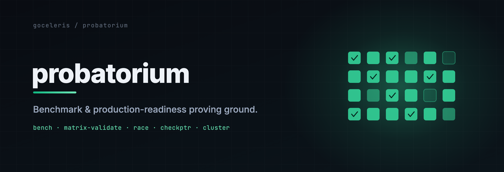

<p align="center">
  
</p>

<p align="center">
  <a href="https://github.com/goceleris/probatorium/actions/workflows/test.yml?query=branch%3Amain"></a>
  <a href="https://github.com/goceleris/probatorium/actions/workflows/lint.yml?query=branch%3Amain"></a>
  <a href="https://codecov.io/gh/goceleris/probatorium"></a>
  <a href="go.mod"></a>
  <a href="LICENSE"></a>
</p>

<p align="center">
  <strong>The benchmark and validation harness for <a href="https://github.com/goceleris/celeris">celeris</a>.</strong><br>
  It drives a real three-host cluster, x86 and arm64, and asks every celeris build two questions:
  how fast is it, and does it stay correct under stress?
</p>

<p align="center">
  <a href="#where-the-latest-results-live">Latest results</a> ·
  <a href="https://goceleris.dev/benchmarks/">Benchmark dashboard</a> ·
  <a href="https://goceleris.dev/methodology/">Methodology</a> ·
  <a href="#reproduce-a-run">Reproduce a run</a>
</p>

## What it proves

probatorium runs two kinds of tier on the same cluster: bench tiers measure, validation tiers judge.

- **Speed (the bench tier).** celeris runs side by side with a field of 29 other frameworks in 10
  languages and the Go `net/http` baseline: 52 server columns across up to 29 scenarios, 813 cells. The
  load comes from [loadgen](https://github.com/goceleris/loadgen). Besides saturation throughput, the
  headline metric is **`latency_at_slo`**: the highest request rate whose P99 stays within each latency
  budget. Rated runs are published to [goceleris.dev](https://goceleris.dev/benchmarks/).
- **Correctness (the validation tiers).** Every reference app (8 of them, covering celeris's middleware,
  streaming and database drivers) runs on every engine (`iouring`, `epoll`, `std`, `adaptive`) on both
  architectures: 64 cells per full matrix. Each cell is hit with session-shaped traffic, malformed
  HTTP/1.1, h2c-upgrade churn, WebSocket frame torture, killed SSE streams and a replayed fault
  schedule, while a per-second property loop checks invariants such as connection accounting, heap,
  goroutine and RSS growth, and unexpected panics. `mage ValidateGate` fails the run on any violation,
  dead cell or unexercised oracle. `mage ValidateDiff` fails it when one engine or one architecture
  behaves differently from the others.
- **The same checks under instrumented builds.** Race Validation rebuilds the reference apps with
  `-race`; Checkptr Validation rebuilds them with the pointer checker, which also compiles in celeris's
  own io_uring SQE checks.
- **Flake rates, off the cluster.** Celeris Stress runs celeris's own tests many times on GitHub-hosted
  x86 and arm64 runners and reports, per test and architecture, the per-process failure rate with an
  exact 95 % interval ([`docs/STRESS.md`](docs/STRESS.md)).

## Where the latest results live

Every cluster tier is a GitHub Actions workflow in this repository. Its run page is the latest result:
the gate steps (`mage ValidateGate`, `mage ValidateDiff`) give the verdict, and the full result tree is
attached to the run as an artifact.

> [!NOTE]
> **The tiers are dispatched by hand.** Their schedules have been paused since
> [#380](https://github.com/goceleris/probatorium/pull/380) (2026-09-15) to keep the cluster free for
> the v1.6.0 release validation; [`workflow_schedule_paused_test.go`](workflow_schedule_paused_test.go) pins that state. The run lists
> below show the most recent manual runs, not a nightly or weekly cadence.

| Tier (links to its runs) | What it runs | Result artifact on each run (kept for) |
| --- | --- | --- |
| [Nightly Validation](https://github.com/goceleris/probatorium/actions/workflows/matrix-nightly-tier.yml) | The full 64-cell matrix on both architectures | `matrix-nightly-results-<run id>` (30 days) |
| [Weekend Soak](https://github.com/goceleris/probatorium/actions/workflows/matrix-weekend-tier.yml) | The same matrix over 24 h, long enough to judge slow leaks | `matrix-weekend-results-<run id>` (90 days) |
| [Race Validation](https://github.com/goceleris/probatorium/actions/workflows/matrix-race-tier.yml) | The matrix with `-race` reference apps | `matrix-race-results-<run id>` (30 days) |
| [Checkptr Validation](https://github.com/goceleris/probatorium/actions/workflows/matrix-checkptr-tier.yml) | The matrix with pointer-checker reference apps | `matrix-checkptr-results-<run id>` (30 days) |
| [PR Validation](https://github.com/goceleris/probatorium/actions/workflows/matrix-pr-tier.yml) | A 10-minute matrix on the amd64 host, for pull requests a maintainer labels `cluster-ok` | `matrix-pr-results-<run id>` (7 days) |
| [Benchmark Tier](https://github.com/goceleris/probatorium/actions/workflows/benchmark-tier.yml) | `mage BenchTier` over the whole grid | `benchmark-tier-results-<run id>` (90 days); rated runs are also published to the [benchmark dashboard](https://goceleris.dev/benchmarks/) |

Validation results are not published anywhere else: they are not in
[goceleris/docs](https://github.com/goceleris/docs) or on goceleris.dev. Every cluster run also keeps
a `cluster-forensics-*` and a `cluster-rescued-results-*` artifact for 90 days. How the benchmark
numbers are made is described on the [methodology page](https://goceleris.dev/methodology/).

## Reproduce a run

**Without the cluster.** Two parts of the harness are deterministic and run on any machine with Go:

```sh
# The bench grid: every (scenario, server) cell a full run schedules (813 of them), without running any.
go run ./cmd/runner -dry-run -cells '*/*' -runs 1

# A validation seed: a found bug is the tuple (seed, celeris commit, host arch), and the seed expands
# into the same workload and fault schedule every time.
go run ./cmd/validator-replay -seed=0x1 -commit="$(git rev-parse HEAD)" -target=msa2-server -dry-run
```

**On the cluster.** Everything else drives the three hosts through [mage](https://magefile.org) targets
and Ansible, so it needs Linux or macOS with `mage` and `ansible-playbook`, and SSH access to the
cluster in [`ansible/inventory.yml`](ansible/inventory.yml). `CLUSTER_USE_LAN=1` routes Ansible's SSH
over the 20G LACP fabric (`192.168.50.0/24`) instead of the Tailscale overlay and records that fabric
in the results; bench load always targets the hosts' LAN addresses.

```sh
# Cluster reachability and manifest state (read-only).
mage Status

# Cross-compile and ship the binaries. DEPLOY_COMPETITORS=go-only skips the native toolchains;
# DEPLOY_NEEDS_DBSERVICES=1 pulls the postgres/redis/memcached images the driver_* apps need.
CLUSTER_USE_LAN=1 DEPLOY_COMPETITORS=go-only DEPLOY_NEEDS_DBSERVICES=1 mage Deploy

# Smoke bench: two cells on the amd64 host.
CLUSTER_USE_LAN=1 \
  BENCH_TARGET=msa2-server \
  BENCH_CELLS='get-json/stdhttp-h1,get-json/gin-h1' \
  BENCH_DURATION=15s BENCH_WARMUP=3s \
  mage Bench

# Full validation matrix on the amd64 host: every reference app on every engine.
CLUSTER_USE_LAN=1 \
  VALIDATE_TARGET=msa2-server VALIDATE_DURATION=10m \
  VALIDATE_MATRIX=1 VALIDATE_DBSERVICES=1 \
  mage Validate

# Judge it the way the tiers do.
mage ValidateGate

# Return every host to its pristine state.
CLUSTER_USE_LAN=1 mage Cleanup
```

A maintainer can also start any tier from its workflow page (**Run workflow**) or with
`gh workflow run <workflow file> --repo goceleris/probatorium`. The tiers share one concurrency group,
so a new run queues behind the one on the cluster.

## The cluster

Three hosts, defined in [`ansible/inventory.yml`](ansible/inventory.yml):

| Host | Arch | Role |
| --- | --- | --- |
| msa2-client | amd64 | Load generator (loadgen) for the bench tier |
| msa2-server | amd64 | Server under test; in validation it runs the validator and the reference app |
| msr1 | arm64 | Server under test; in validation it runs the validator and the reference app |

The validator runs on the bench target itself, next to the reference app it drives
([`ansible/validate.yml`](ansible/validate.yml)); msa2-client holds no validation state.

### msr1 NIC interrupt placement

msr1 has two bonded Realtek r8127 ports (enp1s0, enp49s0) with one RX and one TX queue each and no RSS.
The bench pins the TX-completion vector of enp1s0 (interrupt name `enp1s0-8`; its IRQ number changes per boot)
to CPU 1 before every bench run on msr1. This is a host-tuning choice made by the maintainer on 2026-10-17
([goceleris/celeris#1036](https://github.com/goceleris/celeris/issues/1036)), not a measured fact about the
hardware:

- **What the evidence is.** It is exploratory and post hoc. X2: an extra loop on CPU 4 (where the vector sat)
  cleared a whole-port TX stall of about 200 ms in 8 of 8 runs. X3 (run 39060669852): 21 of 21 columns with the
  vector on a loop CPU were clean and 3 of 3 with it on CPU 4 stalled. But the pre-registered gate of that X3
  run failed and its row was INCONCLUSIVE, and the h-irq4to1 arm always ran last, so order is not separated
  from placement. The mechanism (a TX-completion vector serviced by a CPU without a loop stalls the port) is
  the working explanation, not an established one. A +35% rps seen with the vector on CPU 1 is relative to
  CPU 8 and is unexplained; do not quote it as an effect of this placement.
- **What CPU 1 is.** A loop CPU only in celeris's #1049 (C1) layout. The non-celeris columns have no loops
  there, so for them CPU 1 is simply the CPU the vector was put on, and the placement does not mean the same
  thing across engines.

- **Where.** `nic_irq_placement` on the msr1 entry of [`ansible/inventory.yml`](ansible/inventory.yml)
  (`iface`, `vector`, `cpu`), applied by [`ansible/tasks/nic_irq_placement.yml`](ansible/tasks/nic_irq_placement.yml)
  through [`ansible/files/nic_irq_pin.sh`](ansible/files/nic_irq_pin.sh) in the stage play of `bench.yml`.
  Empty or unset means do nothing: msa2-server and msa2-client never have it. A one-off run without it:
  `-e '{"nic_irq_placement": {}}'`. enp49s0's vector is not touched (the maintainer excluded it from the placement).
- **How.** The vector is found by name in `/proc/interrupts`, an explicit single CPU is written to
  `/proc/irq/N/smp_affinity_list`, and both `smp_affinity_list` and `effective_affinity_list` are read
  back. IFACE is bound to the vector: it is accepted when either (a) each IRQ found by that name is listed
  under `/sys/class/net/<iface>/device/msi_irqs/` or (b) the vector name starts with `<iface>-`, and refused
  (exit 2, nothing written) only when both fail; the record says which check passed (`binding`: `msi_irqs` or
  `name`). Either alone suffices because an out-of-tree driver may expose one of them differently. A readback that differs from the
  CPU fails the play before the first cell. It is a pin, not a
  restore: writing the old mask (0-11) back does not return the vector to its previous CPU, the kernel
  picks one from the mask. Applying it again is a no-op. Nothing is undone at teardown.
- **Record.** Every bench run on a host with the placement writes `nic-irq-placement.json` into its run
  directory (interface, vector, binding, irq, cpu, the affinity found before and read back after, and a second
  readback taken after the last cell) and prints the same in the log. `mage Bench` folds it into
  `environment.nic_irq_placement` of the results document and so into `env.json` (schema 5.21); a
  run without a placement has no such key.
- **Where it applies.** Only `bench.yml` pins. `mage Validate` (PR, nightly and checkptr tiers) and the stress
  playbooks do not, so on msr1 their vector placement depends on history: pinned if a bench ran since the
  boot, else the boot default. It is not recorded for them. irqbalance is not handled: nothing stops or
  configures it, so it can move the vector between the pin and the end of a run (the end-of-run readback
  below only detects that).
- **Invariant.** Every bench run records its placement, and a changed placement (another vector, another
  CPU, none) changes comparability: runs are compared only across the same `nic_irq_placement`. The docs
  site does not flag `nic_irq_placement` changes, so the first arm64 publish after this change crosses a
  placement change unflagged. An end-of-run readback that differs from the pin (something moved the vector
  mid-run) or that could not run at all (a become or transport failure) is logged as
  `WARNING: NIC IRQ placement DRIFTED` and recorded as `at_end.verified: false`; treat that run as unplaced.

Tests: `bash ansible/tests/test_nic_irq_pin.sh` (the shell logic against a fake `/proc` and `/sys`; also
runs in a plain container) and `bash ansible/tests/test_nic_irq_placement_play.sh` (the real tasks files
under ansible, run by the ansible CI job; `PROBATORIUM_ANSIBLE_TESTS=1 go test` runs it too). `go test` runs the first.

## Bench tier

### The field

The grid is capability-gated: 52 server columns from `servers.Registry` (the single source of truth,
in [`servers/servers.go`](servers/servers.go)) × 32 registered scenarios, of which 29 schedule cells.
The three `tls-*` scenarios need a TLS terminator that no run configures today.

- **celeris** contributes **9 columns** that pick out an engine, a wire mode and a handler dispatch
  mode: `iouring` (`h1-sync`, `h1-async`, `auto+upg-async`), `epoll` (`h1-sync`, `h1-async`,
  `auto+upg-async`), `adaptive` (`h1-async`, `auto+upg-async`) and `std-h1`. This is how the grid
  separates, for example, an io_uring regression from a wire-mode one.
- **`stdhttp`** is the Go `net/http` baseline (`h1`, `h2`, `hybrid`).
- **29 competitor frameworks across 10 languages** make up the rest:

| Language | Frameworks |
| --- | --- |
| Go (10) | chi, echo, fasthttp, fiber, gin, gnet, gorilla, hertz, iris, nbio |
| Rust (4) | actix-web, axum, hyper, ntex |
| Bun (3) | bunraw, elysia, hono |
| Node / JS (3) | express, fastify, uWebSockets.js |
| C++ (2) | drogon, lithium |
| Java (2) | netty, vertx |
| Python (2) | fastapi, starlette |
| C (1) | h2o |
| C# (1) | aspnet |
| Zig (1) | httpzig |

Count from the registry, not from adapter directories: a directory can exist without being registered.
Adding a framework takes a registry entry and an adapter directory, plus a `nativeBuildSpecs` entry in
[`mage_cluster.go`](mage_cluster.go) for a non-Go adapter.

### Capability gating

Not every scenario runs against every server. Each adapter declares its `Capabilities`, which the runner
projects into a `servers.FeatureSet`, and each scenario implements `Applicable(servers.FeatureSet) bool`.
The scheduler skips the mismatches **before** dialing loadgen, so a framework with no native Postgres
path never shows up as a spurious zero in the driver table. That is why a full run has 813 cells rather
than the raw 52 × 32 product.

### Profiles

`mage BenchTier` runs a **profile** from `budget.ForProfile` ([`budget/`](budget/)). Every profile
covers the same full grid in exactly one pass; they differ in the per-cell window and in whether the
rated sweep runs.

| Profile | Per-cell window | Rated sweep | Published by the Benchmark Tier workflow |
| --- | --- | --- | --- |
| **fast** (the `ForProfile` default) | 35 s active / 10 s warmup | off: saturation only | never (the workflow forces `BENCH_PUBLISH=0`) |
| **headline** | 40 s / 12 s | on | yes, unless dispatched with `publish=false` |
| **full** | 90 s / 20 s | on | yes, unless dispatched with `publish=false` |

The workflow publishes only rated profiles, because saturation-only data would publish datasets with no
`latency_at_slo`. `mage BenchTier` run by hand publishes unless `BENCH_PUBLISH=0`. The workflow sets
`BENCH_BUDGET` per profile (24 h, 36 h and 60 h). The budget model projects about 30 h for headline and
51 h for full. Runs before [#418](https://github.com/goceleris/probatorium/issues/418) measured about 53 h
and 69 h, because they rated every clean cell.

**Rated data is not publishable yet.** [#441](https://github.com/goceleris/probatorium/issues/441) and
[#442](https://github.com/goceleris/probatorium/issues/442) gate any rated publish, so dispatch headline
and full with `publish=false` until both land. The runner keeps no achieved rate per pass, so no rated
number can tell a slow server from load that loadgen never sent (#441). In the two-arch 0829 run, rated
passes that overlapped the other arch's run of the same row, on the shared loadgen host, published
backlog clocks far more often than the rest (#442).

### Result: latency at SLO

In the rated sweep, each cell gets four constant-rate passes at 25, 50, 75 and 90 % of that cell's
saturation RPS, with loadgen's coordinated-omission correction. `latency_at_slo` maps each budget in
`{10, 50, 100, 500, 1000}` ms to the highest pass target whose P99 (the median across runs) stayed within
it. Bigger is better, and it ranks the field where saturation ceilings collapse together, such as the
store-bound driver rows. Only the 401 cells of `budget.RatedScenarios` (every rated scenario on every
server that can serve it) get the sweep: `BenchTier` passes their glob to the runner's `-rated-cells`
(`BENCH_RATED_CELLS`), with the profile's pass window in `BENCH_RATED_DURATION`. The rated rows are the
driver rows, `get-json`, `post-4k`, `churn-close` and `ws-echo`. The other scenarios (`get-simple` and its
concurrency sweep, `get-json-1k`, the H2 rows, `ws-large-echo`, and the WS hub and SSE fan-out rows)
publish saturation data only; [`budget/profiles.go`](budget/profiles.go) gives the measured reason for
each. Datasets published before [#418](https://github.com/goceleris/probatorium/issues/418) also carry
rated data for those scenarios.

## Validation tier

Each validation cell runs Tier 1 and Tier 3 against one reference app on one engine; Tier 2 is still
scaffolding.

### Tier 1: always-on property stress

Five traffic slices fan out over `Concurrency` walker goroutines. The budget activates progressively, so
small smoke runs don't pay for the expensive slices:

| Slice | Share of walkers | Active at concurrency ≥ | What it does |
| --- | --- | --- | --- |
| Markov | ~60 % | 1 | Session-shaped traffic over the reference app's routes, with transitions weighted by `validation/markov/<refapp>.yaml` |
| Adversarial | ~20 % | 1 | Raw-TCP malformed HTTP/1.1: bad chunks, oversized headers, NUL in a header, CRLF injection, slowloris, double Content-Length |
| h2c upgrade churn | ~10 % | 10 | Valid h2c upgrade preambles, then an RST at three different stages. Only `kitchen_sink` runs on `Protocol: celeris.Auto`, so only it completes an upgrade; the other seven serve HTTP/1.1 and decline by design |
| WS frame torture | ~5 % | 4 | A real RFC 6455 handshake, then one of: fragmented reserved opcode, oversize payload, unmasked client frame, ping flood, continuation without start, invalid UTF-8 |
| SSE kill-mid-stream | ~5 % | 4 | Open an SSE stream, hold it 50 to 1500 ms, then RST; the broker must clean up the client slot |

From concurrency 4, two more walkers run outside that budget. One is an RFC conformance scraper that
reads the wire (`I-RFC-1`, `I-RFC-2`). The other is a 64 KiB WebSocket echo (`I-WS-ECHO`), which runs
where `/ws` is routed. The echo holds no connection for the first 18 s of every 54 s: a native engine
keeps each echo's backlog on the Go heap, and these gaps give every `I-MEM-1` trough bucket samples
without one ([`validation/ws_echo_quiet.go`](validation/ws_echo_quiet.go), probatorium#478).

In a stall-capture run (the `stall_capture` dispatch input), a 64 KiB echo fire that times out is held
open: the sender stops, the walker keeps reading, and `ss -tmi` of both ends, the echo and byte
counters, the refapp's per-thread CPU masks and states, its `GOMAXPROCS` and its engine counters are
taken at t0 and t0 + 3 s. A record-only `I-WS-ECHO-STALL` dossier carries `ws-echo-diag.txt`, whose first
line is `WS_ECHO_VERDICT=SLOW_CLASS` (the server read bytes or echoes arrived in the window: slow),
`WEDGE_CLASS` (bytes sit unread and nothing moved) or `INDETERMINATE` (missing data is never a wedge).
The timeout is counted after the second instant. `mage` and the race tier also take two off-by-default
experiment arms for msa2-server only, `refapp_cpus` (a `taskset -c` list of at least 2 CPUs) and
`refapp_workload_hint` (`high` starts the adaptive engine on io_uring); each cell records the arm it
actually ran under in `refapp_sched.txt` ([`validation/ws_echo_diag.go`](validation/ws_echo_diag.go),
[`validation/refapparms`](validation/refapparms), probatorium#481).

The two streaming slices are **routed**. Once per cell, the tier probes `/ws` and `/events` with the
exact request its walker sends, and skips the slice when the reference app answers 404; only
`auth_session_ratelimit` routes them today. The verdict is recorded per cell (`ws_route_probed` /
`ws_route_present` and the `sse_` pair), so a zero is attributable. A matrix run also writes a
per-app coverage table to `streaming-coverage.txt`.

The first time one of these signals appears, the orchestrator acts on it mid-run
([`validation/runner.go`](validation/runner.go)):

| Signal | Predicate | Meaning | On first hit |
| --- | --- | --- | --- |
| adversarial wrong-accepted > 0 | `I-ADV-ACCEPTED` | The server accepted malformed bytes: an RFC violation | hard fail: forensics first, then the cell stops |
| h2c crashed > 0 | `I-H2C-CRASHED` | The engine answered an upgrade with non-HTTP bytes | hard fail: forensics first, then the cell stops |
| WS accepted bad frame > 0 | `I-WS-ACCEPTED` | The server accepted an RFC 6455 violation | hard fail: forensics first, then the cell stops |
| WS hang (no close) > 0 | `I-WS-HANG` | A WebSocket connection hung past the close timeout | hard fail: forensics first, then the cell stops |
| 64 KiB echo corrupt / reordered / missing / timed out | `I-WS-ECHO` | WebSocket echoes were not byte-intact and in order | hard fail: forensics first, then the cell stops |
| process died | `I-LIVENESS` | The reference app crashed mid-run | hard fail: forensics first, then the cell stops |
| process alive but wedged | `I-HANG` | The reference app stopped responding | hard fail: forensics first, then the cell stops |
| h2c hang > 0 | `I-H2C-HANG` | An upgrade was neither answered nor declined within 20 s | dossier without a core dump; the cell runs on |
| WS handshake fail > 0 | `I-WS-HANDSHAKE` | A WebSocket upgrade did not complete within 2 s | dossier without a core dump; the cell runs on |

A zero only means health when the oracle ran. `mage ValidateGate` therefore also fails a `kitchen_sink`
cell whose `h2c_upgraded` is 0 after sending preambles: every churn mode would then have degenerated
into a declined GET, and the h2c oracles would have judged a path the engine never entered. The same
rule covers dead cells (`requests_sent == 0`) and properties that were never evaluated.

### Tier 2: stateful API fuzzing (not implemented)

The intent is RESTler-style producer/consumer inference from `validation/spec/<refapp>.openapi.yaml`, to
catch API-level bugs Tier 1 misses. **The tier is scaffolding today:** `runTierRESTler` parks on the run
context and sends nothing, and every `plan.json` marks the tier `DISABLED` with that reason. Only
`auth_session_ratelimit` ships a spec.

### Tier 3: deterministic seed replay

This is a real kernel with no mocking. A seed expands into a workload plus a fault schedule
(`iptables` drops, `tc netem` loss and delay), so a bug is the tuple `(seed, git_commit, host_arch)` and
reproduces with `validator-replay` (see [Reproduce a run](#reproduce-a-run)). The corpus is the 100
hand-authored seeds in [`validation/corpus/seeds_initial.go`](validation/corpus/seeds_initial.go). Each
cell replays seeds for its whole window at 15 s per seed, looping over the corpus.

### Invariants

Beyond the Tier 1 signals, the orchestrator runs a **per-second property loop** inside every cell
([`validation/propertyloop.go`](validation/propertyloop.go), with the shared evaluator in
[`validation/checker`](validation/checker)). Once the reference app announces its address, the loop:

- polls its `/debug/vars`, which every reference app serves through
  `validation/refapp/internal/debugvars`, alongside `/debug/pprof` for forensics;
- samples its RSS from `/proc`;
- evaluates the registered `I-*` predicates against a rolling one-hour history.

Every violation is counted into `tier_1.property_violations` / `property_violation_ids`, and
`mage ValidateGate` fails on any of them. What the first violation does to the *cell* is a switch:

- **Record-only** (the default): an incident dossier with live forensics (`/proc`, the `/debug/pprof`
  profiles, gcore, dmesg) is written while the reference app is still running. The cell then continues to
  its budget, so a leak's whole trajectory is on record.
- **Hard fail** (the validator's `-property-hard-fail`, or `VALIDATE_PROPERTY_HARD_FAIL=1` in its
  environment, which `ansible/validate.yml` sets from the `validate_property_hard_fail` extra-var): the
  same dossier is captured *before* the tiers are torn down, then the cell is cancelled and the validator
  exits non-zero.

Each cell reports `properties_passed`, `properties_failed`, `properties_not_instrumented` and
`properties_not_judged`. A predicate counts as passed only if it reached a **verdict** at least once and
never failed. One that only ever skipped (its window never became judgeable) is `not_judged`; one with no
data source is `not_instrumented`. By default the gate also fails a cell whose loop never evaluated
anything (`/debug/vars` unreachable), unless `tier_1.property_loop_skipped` names a reason.

Judged in every cell:

- `I-LIVENESS` / `I-HANG`: the reference app stayed up and responsive (judged from the walkers, not the
  snapshot loop).
- `I-PANIC`: no *unexpected* panic. This is `celeris.panic_count` from `/debug/vars` minus the panics
  the traffic corpus designs in, and it must persist for 3 samples.
- `I-CONN-2`: `accepted − closed − active == 0`, judged only when the drift keeps the same sign for 30
  samples.
- `I-MEM-1`: the `heap_inuse` trough slope is at most 1 KB/s over the trailing min(1 h, elapsed), after a
  5-minute warm-up, from 10 minutes of samples.
- `I-MEM-3`: the goroutine-count trough slope is at most 0.2/s over the trailing 10 minutes after
  warm-up.
- `I-MEM-4`: the RSS trough slope is at most 64 KB/s over the trailing min(1 h, elapsed) after warm-up
  (Linux, local driver).

The three slope oracles share a false-positive guard:
- The fit runs over per-150 s bucket **minima**, so a GC sawtooth cannot pass for a slope.
- A slope above budget counts only if the rise across the window also clears a floor, so one legitimate
  step (a cache filling once, a standby engine spinning up) cannot fire it. The floor is the larger of
  budget × 10 minutes, a fraction of the series' level (3 % heap, 5 % goroutines and RSS) and, for the
  heap, 8× its sampling noise and the rise the cell's own trough scatter can explain: the fitted slope
  must be significant (one-sided 0.001, a critical value per trough count) against the scatter of the
  window's troughs, estimated from their successive differences. **That is not free.** Measured against
  the rule without the term on the weekend soaks' 45 minute cells (25 noisy observability cells, trough
  sd 0.34-1.4 MB; 162 quiet cells; detected/sustained counts; all tables and the case definitions are in
  probatorium#520):
  - Noisy cells, straight leak from the end of warm-up: 1 KB/s is called in 9 of 25 cells (24 without
    the term), 2 KB/s in 24 (25), and a 3 KB/s leak about 11 minutes later (median 17.5 -> 28.7 min).
  - Noisy cells, a leak that starts late: from minute 20, 3 KB/s 25/25 -> 22/19; from minute 25, 3 KB/s
    21/10 -> 12/3, 4 KB/s 25/22 -> 21/10, 6 KB/s 25/25 -> 24/21.
  - Noisy cells, a stepped leak of 3 KB/s on average: 11 minutes later with a step every 15 minutes
    (median 23.7 -> 35.0), sustained 21 -> 9 with a step every 30.
  - Quiet cells, straight leak: 3 KB/s is called 3.7 minutes later at the median and 6.2 at most;
    1 KB/s in 146 of 162 cells instead of 150. Late-start and stepped leaks: up to 2.5-5 minutes later.
  - **Quiet cells, a leak that stops.** A leak that starts at the end of warm-up, runs 7.5 minutes and
    then plateaus is lost: 3 KB/s 154/153 -> 64/18 (90 quiet cells lost), 4 KB/s 162/156 -> 125/75,
    6 KB/s 162/162 -> 156/153; 3 KB/s for 10 minutes 162/162 -> 157/149. The estimator, not a floor
    that is too high, is the cause: an instant 2 MB step is still called in 156 cells, as without the
    term. After the leak stops, the shifted successive differences sit in windows of 6-8 troughs where
    the 75 % trim drops only one difference, which inflates the scatter estimate. The other floors do
    not catch it.
  - A single low trough (a 2-4 MB dip at minute 10-15) delays a 3-5 KB/s call by a median of 7.5-11.2
    minutes (max 11.2-13.7) on quiet cells, beyond the 10 minute maximum the straight-leak tests allow.
  - A single 1 MB step is called in 139 of 150 quiet cells that the rule without the term calls.
  - Cells that scatter heavily though quiet (1-2 MB of added trough scatter): 3 KB/s is lost in 19
    (1 MB) to 123 (2 MB) of 162 cells, and a 4 MB sawtooth loses 161. In the same cells with no leak
    the rule without the term trips falsely in 59 of 162 and this rule in none.
  - Short cells: the scatter term needs the load phase to last long enough for windows of 8 or more
    troughs. With the load phase cut to 20 minutes the quiet cells lose 99 of 162 at 3 KB/s, 75 at
    5 KB/s and 32 at 10 KB/s (noisy cells 22-25 of 25); at 25 minutes none are lost.
  - Windows of 5-8 troughs judge only a leak that is large against the scatter.
  - Nothing the floor absolves is hidden. The validator runs I-MEM-1 as it was before the floor
    beside the gated rule, on the same series, and records it per cell as `property_informational`
    (schema 5.20) with its violation count, the evaluations the gated rule absolved and a flag for a
    cell it absolved entirely. `mage ValidateGate` prints it on every run under "informational, NOT
    gating (the pre-scatter-floor rule of I-MEM-1 ...)". The gate never reads it: the verdict is the
    gated rule's alone. A reader of a soak sees every trip the floor absolved and can judge it.
  - The maintainer accepted these costs on 2026-10-17 after five pre-registered attempts (probatorium#520;
    the two later estimators that did not work, and why, are in its description).
- A verdict must persist for 150 consecutive evaluations before it is declared.

These oracles need cells of 15 minutes or more to judge at all, and I-MEM-1 needs about 25 minutes of
sustained load to keep its sensitivity: a shorter load phase loses leaks (see the cost list above). They
judge in the weekend soak's cells (about 45 minutes each: 24 h over 32 cells per architecture, which is
unaffected), and are `not_judged` in the short nightly cells.

Judged only where their data source exists, and reported as `not_instrumented` everywhere else:

- `I-MW-*`: only the apps that install the middleware.
- `I-DRV`: the three driver apps, which read every write back and publish the hit/miss tally.
- `I-RFC-1` / `I-RFC-2`: the conformance scraper, at concurrency ≥ 4.
- `I-CONN-1`: the per-connection last-byte table.
- `I-CHECKPTR`: Checkptr Validation cells; `I-ENG-IOURING`: that tier's io_uring cells.
- `I-RACE`: Race Validation cells, which count `WARNING: DATA RACE` reports on stderr.
- `I-ENG-ADAPTIVE`: adaptive cells.
- `I-MEM-2`: cells of 20 minutes or more, which idle the app twice, after a 60 s burst and at the end.

### Cross-engine and cross-arch divergence

A matrix run's `validate-results.json` holds one `Cells[]` entry per `(refapp, engine, arch)`.
`mage ValidateDiff` compares the two latest matrix documents and reports:

- **cross-engine** divergence: a counter non-zero on one engine (say `iouring`) but zero on another for
  the same `(refapp, arch)`, which is typically an engine-specific bug;
- **cross-arch** divergence: the same shape, comparing amd64 with arm64.

It exits non-zero on HIGH severity, and on MEDIUM too with `VALIDATE_DIFF_STRICT=1` (which every
validation tier sets). It writes `validate-diff/diff.{txt,json}`.

## Reference apps

Each reference app is a **separate Go module** under [`validation/refapp/`](validation/refapp/), so the
validator never pulls in every middleware's dependency graph. The matrix runner discovers them at
runtime.

| Slug | Coverage |
| --- | --- |
| `auth_session_ratelimit` | Session cookie, rate limit, and the WebSocket / SSE detach paths (the only app that routes `/ws` and `/events`) |
| `auth_jwt_csrf` | JWT (HS256), CSRF synchronizer token, keyauth |
| `kitchen_sink` | 17 stateless middlewares (basicauth, bodylimit, cache, circuitbreaker, cors, etag, healthcheck, idempotency, methodoverride, ratelimit, recovery, redirect, requestid, rewrite, secure, singleflight, timeout). The only app on `Protocol: celeris.Auto`, so it is where the h1→h2c upgrade path is exercised |
| `driver_postgres` | celeris's native Postgres driver, `session/postgresstore`, and the `I-DRV` read-after-write tally |
| `driver_redis` | The native Redis driver, `session/redisstore` and a Redis-backed rate limiter |
| `driver_memcached` | The native memcached driver, `session/memcachedstore` and a memcached-backed rate limiter |
| `observability` | logger, metrics and otel middleware |
| `static_swagger_proxy` | static (`embed.FS`), swagger (OpenAPI 3.0) and proxy (X-Forwarded-For trust) |

Each follows the same shape: its own `go.mod`, `resolveEngine("auto")` (io_uring on Linux, std elsewhere),
signal-driven graceful shutdown, and a `ready addr=<bind-addr>` startup line.

## Mage targets

| Target | What it does | Main knobs |
| --- | --- | --- |
| `Status` | Cluster reachability and manifest state | |
| `Deploy` | Cross-compile and stage every binary | `CLUSTER_USE_LAN`, `DEPLOY_COMPETITORS=all\|go-only\|none\|<list>`, `DEPLOY_NEEDS_DBSERVICES` |
| `Cleanup` | Undo what a run installed, per the host manifests | `CLEANUP_HOSTS=all\|<list>` |
| `Bench` | One bench run | `BENCH_TARGET` (default `both`), `BENCH_CELLS`, `BENCH_COMPETITORS`, `BENCH_DURATION`, `BENCH_WARMUP`, `BENCH_RATED`, `BENCH_RATED_DURATION`, `BENCH_RATED_CELLS` (default: the rated cells), `BENCH_SUT_ENV`, `CELERIS_VERSION` |
| `BenchTier` | A profile-driven run over the whole grid; publishes it unless `BENCH_PUBLISH=0` | `BENCH_PROFILE=fast\|headline\|full`, `BENCH_BUDGET`, `BENCH_TARGET`, `BENCH_SKIP_RATED`, `BENCH_PUBLISH` |
| `BenchSince` | Compare against a baseline version | `BASELINE_VERSION` (default `v1.4.2`), `REGRESSION_THRESHOLD` (default `0.05`) |
| `Validate` | A validation run, one cell or the matrix | `VALIDATE_TARGET` (default `both`), `VALIDATE_DURATION` (default `6h`), `VALIDATE_MATRIX=1`, `VALIDATE_MATRIX_REFAPPS`, `VALIDATE_MATRIX_ENGINES`, `VALIDATE_PARALLEL=1`, `VALIDATE_DBSERVICES=1`, `VALIDATE_CONCURRENCY`, `VALIDATE_RESUME_FROM`, `CELERIS_VERSION`, `PROBATORIUM_VALIDATE_DRIVER=ssh` |
| `Soak` | A long validation run | `SOAK_DURATION` (default `24h`), plus the `Validate` knobs |
| `ValidateGate` | The absolute gate over the most recent run's `validate-results.json` on every host | `VALIDATE_GATE_EXPECT_CELLS`, `VALIDATE_GATE_EXPECT_ADAPTIVE_SWITCH` |
| `ValidateDiff` | The cross-engine and cross-arch gate | `VALIDATE_DIFF_STRICT=1` (MEDIUM fails too), `VALIDATE_DIFF_HOSTS=a,b` |
| `BuildRaceRefapps` | Cross-build the `-race` reference apps (the race runtime needs cgo) | |
| `HostSamplerStart` / `HostSamplerStop` | Start and stop the read-only host sampler on every cluster host | `SAMPLER_DURATION`, `SAMPLER_INTERVAL`, `SAMPLER_TAG` |
| `Publish` | Write the newest bench run into goceleris/docs and fire the `benchmark-published` pointer | `PUBLISH_VERSION`, `PUBLISH_VIA=git\|contents`, `PUBLISH_DRYRUN=1`, `DOCS_REPO_DIR`, `DOCS_TOKEN`, `BENCH_PUBLISH_FORCE` |
| `PublishValidate` | Kept for callers; it runs `Publish` | |
| `BenchAndValidate` | `Validate` → `ValidateDiff` (when `VALIDATE_TARGET=both`) → `Bench` → `Publish` | the knobs of each |
| `Fuzz` | Hostile-input fuzzing through `ansible/fuzz.yml`. **Not working today:** the playbook passes validator flags (`-mode`, `-url`) that `cmd/validator` does not define | `FUZZ_DURATION`, `FUZZ_CORPUS` |

`VALIDATE_PARALLEL=1` on a two-arch run drives the two targets concurrently, halving the wall-clock of
long soaks.

### Matrix mode (`VALIDATE_MATRIX=1`)

Matrix mode iterates the `(refapp × engine)` cells and runs a fresh orchestrator per cell with a budget
of `total_duration / len(cells)`. It emits one `validate-results.json` with `Cells[]` populated. Filter
the matrix with:

- `VALIDATE_MATRIX_REFAPPS=driver_postgres,driver_redis` to limit the reference apps;
- `VALIDATE_MATRIX_ENGINES=iouring,epoll` to limit the engines. The default is the OS production set:
  iouring, epoll, std and adaptive on Linux, std elsewhere.

**A failing cell does not stop the run**, because cluster time is the scarce resource. Every cell carries
a `status`:
- `ok`;
- `failed`: it ran, then something failed it;
- `not_run`: it produced no requests and no property verdicts, because its app never started.

Each cell also carries the verbatim `failure_reason`. For a cell that never came up, that is the driver's
own account of why. The ledger names the cell's evidence (`refapp_stderr_tail.txt`, else the incident
dossier) only when that evidence has content. The end of the run prints the ledger and leaves it in
`cell-failures.txt`. The exit status is still non-zero for any cell that did not pass: this is a gate,
not a report.

Three conditions stop the run immediately, because none of them leaves a later cell able to measure
anything:
- the remote driver cannot be built;
- the reference-app staging directory is unreadable;
- a write fails with `ENOSPC`.

Two caps bound the damage when the matrix is failing wholesale:
- **8 consecutive** failures;
- **half the plan** failed in total.

Override them with `PROBATORIUM_MATRIX_MAX_CONSECUTIVE_FAILURES` / `PROBATORIUM_MATRIX_MAX_FAILED_CELLS`
(negative disables); `mage Validate` carries both across the SSH boundary. The weekend soak sets the
total cap to 8. Whatever stops a run early, the summary names the cells it never attempted and prints the
`-matrix-resume-from` line that finishes them.

## Result layout

The key files a run leaves under `results/`:

```text
results/<ts>-bench-<version>/
  results.json                           # the run's roll-up (results-amd64.json + results-arm64.json with BENCH_TARGET=both)
  <TS>-bench-<bench_target>/<RR>-<competitor>/
    run0/<scenario>/<server>.json        # per-cell runner result: the ingested data
    server.log, cpu.*.log

results/<ts>-validate-<bench_target>-<refapp>/   # fetched back from the bench target
  validate-results.json
  cell-failures.txt                      # matrix runs: every cell that failed or never ran, with its reason
  streaming-coverage.txt                 # matrix runs: per-app ws/sse routing table
  cell-<NN>-<refapp>-<engine>/
    validate-results.json                # the cell's own document
    refapp_stderr_tail.txt               # the app's last words (why a not_run cell never started)
    incidents/<ts>-<predicate>/          # forensics dossier per violation

<parent of the two compared runs>/validate-diff/
  diff.txt, diff.json                    # ValidateDiff findings
```

The document types and the current `SchemaVersion` live in [`report/schema.go`](report/schema.go). A
single-cell run leaves `Cells[]` empty and fills `tier_1` / `tier_3` at the top level. Sub-tallies are
`map[string]int64`, so the schema does not re-version when the validator grows a counter.

## Continuous integration

| Workflow | Trigger today | Runs on | Role |
| --- | --- | --- | --- |
| `test.yml` (Test) | push to `main`, pull requests | GitHub-hosted | `go test -race` over the root module, every adapter module, the reference apps, the mage-tagged files and the field guard, plus govulncheck. The `ci-ok` fan-in is a required check |
| `lint.yml` (Lint) | push to `main`, pull requests | GitHub-hosted | `go vet`, golangci-lint, gofmt and actionlint (required) |
| `coverage.yml` (Coverage) | push to `main`, pull requests | GitHub-hosted | Coverage upload to Codecov |
| `matrix-pr-tier.yml` (PR Validation) | pull requests labeled `cluster-ok` (path-filtered), manual | cluster | 10-minute matrix on msa2-server, with `ValidateDiff` |
| `matrix-nightly-tier.yml` (Nightly Validation) | manual (schedule paused) | cluster | Full matrix, both architectures, `ValidateGate` + `ValidateDiff` |
| `matrix-weekend-tier.yml` (Weekend Soak) | manual (schedule paused) | cluster | The same over 24 h by default |
| `matrix-race-tier.yml` (Race Validation) | manual | cluster; the `-race` apps are built on a GitHub-hosted runner | Full matrix with `-race` apps |
| `matrix-checkptr-tier.yml` (Checkptr Validation) | manual | cluster | Full matrix with pointer-checker apps |
| `benchmark-tier.yml` (Benchmark Tier) | manual (schedule paused) | cluster | `mage BenchTier`; publishes rated profiles |
| `publish-results.yml` | manual; also logs `benchmark-published` dispatches | GitHub-hosted | Re-send the pointer for a cell already pushed to goceleris/docs |
| `celeris-stress.yml` (Celeris Stress) | manual; pull requests that change it or `tools/stresstally` (self-test) | GitHub-hosted x86 and arm64 | Run celeris tests many times to measure a flake and its rate; see [`docs/STRESS.md`](docs/STRESS.md) |

The cluster tiers share `concurrency: matrix-tier-cluster` with `cancel-in-progress: false`, so they never
overlap on the cluster. The group keeps only one pending run, so a newer queued run replaces an older
one. Each tier provisions runners, runs on the cluster, then tears the runners down.

### Self-hosted runner bootstrap

Cluster runners are provisioned per run and torn down at the end:

- [`.github/actions/cluster-runner-up/`](.github/actions/cluster-runner-up/) joins the tailnet with a
  SHA-pinned `tailscale/github-action` (an ephemeral `tag:ci` node), mints a registration token, runs
  [`ansible/runner-setup.yml`](ansible/runner-setup.yml) and checks that the runners came online.
- [`.github/actions/cluster-runner-down/`](.github/actions/cluster-runner-down/) collects forensics,
  rescues results to `/var/lib/celeris-rescue`, cleans the hosts, writes a "Resume candidates" job
  summary, mints a removal token, runs [`ansible/runner-teardown.yml`](ansible/runner-teardown.yml) and
  sweeps orphaned registrations.
- Runners live under `/tmp/actions-runner-<host>/`, with no systemd unit and no package install.

The one-time operator setup (four repository secrets and a Tailscale ACL rule) is documented in
[`ansible/RUNNER_BOOTSTRAP.md`](ansible/RUNNER_BOOTSTRAP.md). Resuming an interrupted matrix after a power
event is covered in [`ops/power/README.md`](ops/power/README.md).

## Related projects

| Project | What it is |
| --- | --- |
| [celeris](https://github.com/goceleris/celeris) | The HTTP engine for Go that probatorium benchmarks and validates |
| [loadgen](https://github.com/goceleris/loadgen) | The HTTP/1.1 and HTTP/2 load generator the bench tier drives, as a library |
| [docs](https://github.com/goceleris/docs) | The source of [goceleris.dev](https://goceleris.dev), where rated bench runs are published |

## Contributing

See [CONTRIBUTING.md](CONTRIBUTING.md) for setup, the checks CI runs and the `cluster-ok` label, and
[SECURITY.md](SECURITY.md) to report a vulnerability.

## License

Apache-2.0. See [LICENSE](LICENSE).
